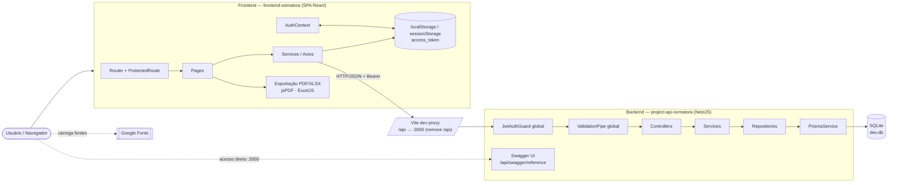
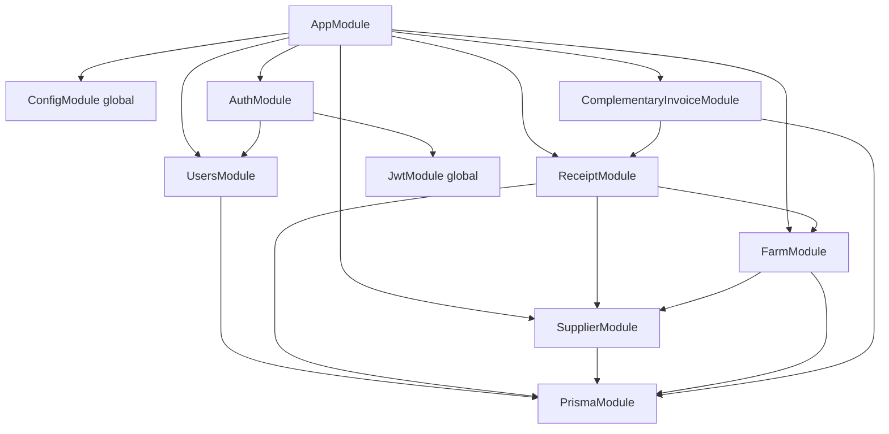
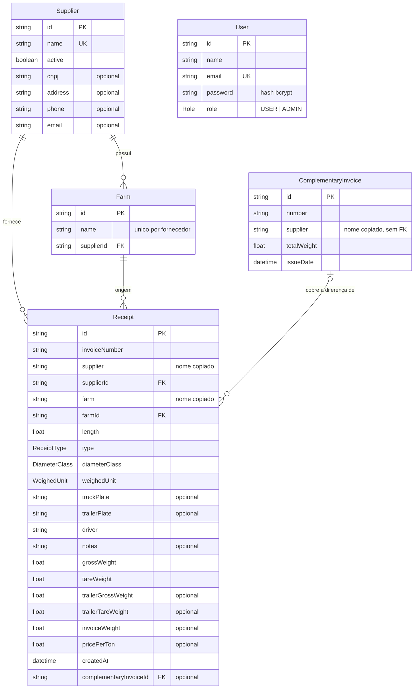
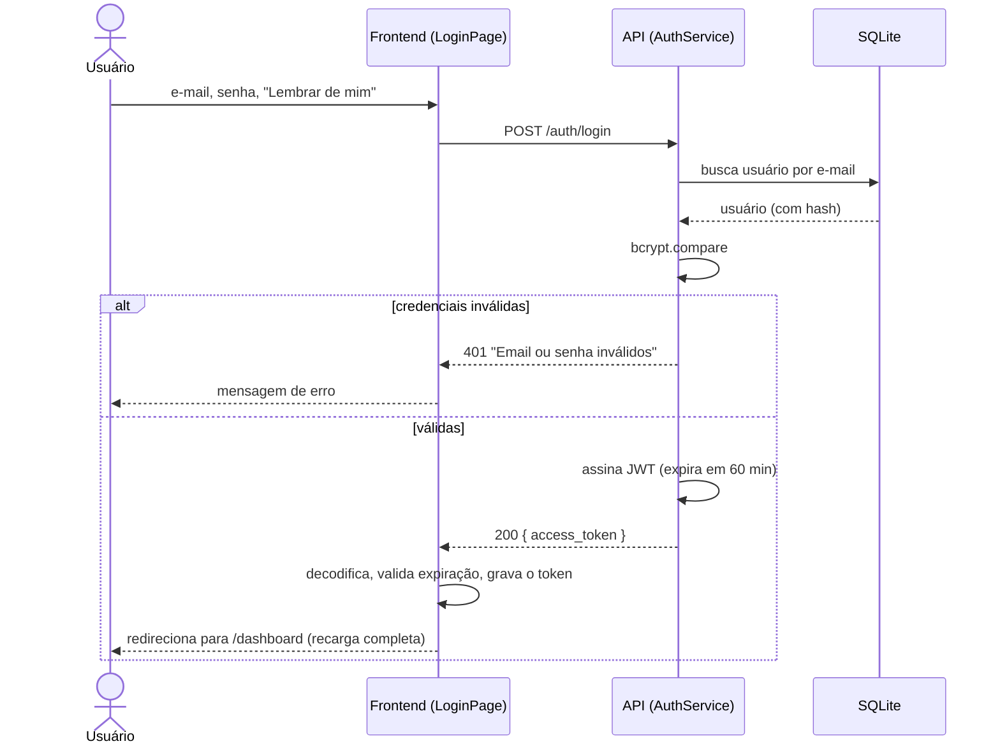
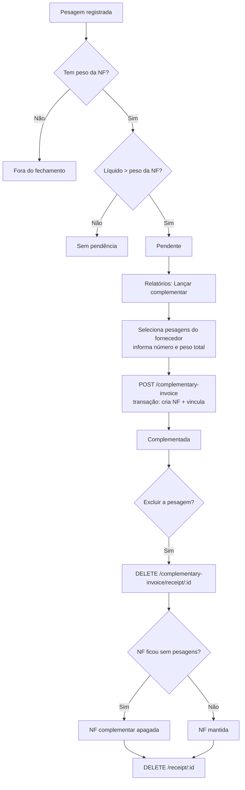

# Documentação Técnica do Sistema — SOMAPAR · Pesagem & Recebimento

> **Convenções deste documento**
>
> | Marcação | Significado |
> | --- | --- |
> | **Implementado** | Existe no código e está ligado ao fluxo do sistema |
> | **Parcial** | Existe, mas incompleto ou com defeito conhecido |
> | **Código não utilizado** | Existe no código, mas nenhum fluxo o aciona |
> | **Não implementado** | Há indício visual/textual (menu, link, comentário), mas não há implementação |
> | **Não identificado no projeto** | Nenhum indício encontrado nos repositórios |
> | **A confirmar** | Não foi possível determinar com segurança apenas pelo código |
>
> Tudo o que está descrito aqui foi extraído do código-fonte, das configurações e do histórico Git dos dois repositórios. Onde há inferência, ela está sinalizada.

---

## 1. Informações do Documento

| Campo | Informação |
| --- | --- |
| Nome do sistema | **SOMAPAR — Pesagem & Recebimento** (nome exibido na interface). Nomes técnicos: `frontend-somatora` (frontend) e `project-api-somatora` (API; título Swagger "API / SOMATORA") |
| Versão | Frontend `0.0.0` · Backend `0.0.1` (campo `version` dos `package.json`). Não há tags Git nem versionamento de release |
| Status | Em desenvolvimento. Não identificado ambiente de produção, pipeline de deploy ou release publicado |
| Data da documentação | 07/10/2026 |
| Responsável | Não informado. O histórico Git dos dois repositórios tem um único autor de commits: João Junior |
| Base analisada — frontend | Repositório `frontend-somatora`, branch `main`, commit `1907214`, árvore de trabalho limpa |
| Base analisada — backend | Repositório `project-api-somatora`, commit `9948a29` **mais alterações locais não commitadas** em `src/auth/` (ver [§18.9](#189-divergência-entre-o-commit-e-a-árvore-de-trabalho)) |
| Tecnologias principais | React 19, TypeScript, Vite 8, Tailwind CSS 4, React Router 8, Axios · NestJS 11, Prisma 7, SQLite (better-sqlite3), JWT, bcrypt, class-validator, Swagger |

---

## 2. Controle de Versão do Documento

| Versão | Data | Autor | Descrição |
| --- | --- | --- | --- |
| 1.0 | 07/10/2026 | Não informado (gerado por análise assistida do código-fonte) | Criação da documentação |
| 1.1 | 07/10/2026 | Não informado (gerado por análise assistida do código-fonte) | Segredo do JWT voltou a ser lido de `JWT_SECRET`; arquivo `constants.ts` removido (DT-001 resolvido) |

---

## 3. Sumário

1. [Informações do Documento](#1-informações-do-documento)
2. [Controle de Versão do Documento](#2-controle-de-versão-do-documento)
3. [Sumário](#3-sumário)
4. [Visão Geral do Sistema](#4-visão-geral-do-sistema)
5. [Escopo do Sistema](#5-escopo-do-sistema)
6. [Requisitos do Sistema](#6-requisitos-do-sistema)
7. [Perfis e Permissões](#7-perfis-e-permissões)
8. [Arquitetura do Sistema](#8-arquitetura-do-sistema)
9. [Diagrama de Arquitetura](#9-diagrama-de-arquitetura)
10. [Tecnologias e Stack](#10-tecnologias-e-stack)
11. [Estrutura do Projeto](#11-estrutura-do-projeto)
12. [Backend](#12-backend)
13. [API](#13-api)
14. [Documentação OpenAPI / Swagger](#14-documentação-openapi--swagger)
15. [Frontend](#15-frontend)
16. [Banco de Dados](#16-banco-de-dados)
17. [Modelo de Dados](#17-modelo-de-dados)
18. [Autenticação e Autorização](#18-autenticação-e-autorização)
19. [Segurança](#19-segurança)
20. [Tratamento de Erros](#20-tratamento-de-erros)
21. [Validações e Regras de Negócio](#21-validações-e-regras-de-negócio)
22. [Integrações](#22-integrações)
23. [Configuração do Ambiente](#23-configuração-do-ambiente)
24. [Instalação](#24-instalação)
25. [Execução](#25-execução)
26. [Build e Deploy](#26-build-e-deploy)
27. [Testes](#27-testes)
28. [Logging e Monitoramento](#28-logging-e-monitoramento)
29. [Desempenho e Escalabilidade](#29-desempenho-e-escalabilidade)
30. [Manutenção e Evolução](#30-manutenção-e-evolução)
31. [Débitos Técnicos e Pontos de Atenção](#31-débitos-técnicos-e-pontos-de-atenção)
32. [Melhorias Recomendadas](#32-melhorias-recomendadas)
33. [Funcionalidades Futuras](#33-funcionalidades-futuras)
34. [Glossário](#34-glossário)
35. [Conclusão](#35-conclusão)
36. [Anexos](#36-anexos)
37. [Diagnóstico Técnico do Projeto](#37-diagnóstico-técnico-do-projeto)

---

## 4. Visão Geral do Sistema

### 4.1 Objetivo

Sistema web interno para registrar o **recebimento de madeira em tora por pesagem** (romaneio de entrada) e fazer o **fechamento de notas fiscais complementares** por fornecedor — isto é, apurar a diferença entre o peso efetivamente recebido na balança e o peso declarado na nota fiscal original, e controlar quais diferenças já foram cobertas por uma NF complementar.

### 4.2 Problema que resolve

A própria interface declara o propósito na tela de fechamento: *"Recebido vs. faturado por fornecedor — substitui a planilha de fechamento"*. O sistema centraliza o que antes era controle em planilha: cadastro das pesagens, cálculo do peso líquido, apuração de diferenças por fornecedor e emissão de relatório em PDF/XLSX.

### 4.3 Contexto de utilização e usuários

| Item | Descrição |
| --- | --- |
| Contexto | Uso interno ("Sistema interno de pesagem e recebimento", texto da tela de login). A listagem de pesagens é descrita como "Recebimentos registrados na portaria" |
| Usuários | Operadores (perfil `USER`) e administradores (perfil `ADMIN`) |
| Idioma | Interface em português (pt-BR); código e contratos de API em inglês |
| Dispositivo | Navegador desktop. Layout com barra lateral fixa de 260 px; não há tratamento específico para telas pequenas nas áreas autenticadas |

### 4.4 Principais funcionalidades

- Login com e-mail e senha (JWT).
- Painel com indicadores: pesagens do dia, volume do mês, fornecedores atendidos, peso líquido médio, gráfico dos últimos 6 meses, pendências de fechamento e atividade recente.
- Cadastro, edição e exclusão de pesagens (`Receipt`), com três modalidades de unidade pesada (cavalo + julieta, só cavalo, só julieta).
- Cadastro de fornecedores e suas fazendas; ativação/desativação de fornecedor.
- Fechamento por fornecedor e período; lançamento de NF complementar vinculando pesagens pendentes.
- Emissão de relatório de fechamento com filtros e exportação para PDF e XLSX.
- Listagem e criação de usuários (somente administrador, na interface).

### 4.5 Benefícios esperados

Derivados do que o código faz: eliminação da planilha de fechamento, cálculo automático do peso líquido e da diferença em relação à NF, rastreio do que está pendente de complementar e padronização das classes de madeira e diâmetro.

### 4.6 Limitações conhecidas

- Banco **SQLite em arquivo local**; sem estratégia de backup, deploy ou alta disponibilidade definida.
- **Autorização por perfil existe apenas na interface**; a API não diferencia `USER` de `ADMIN` ([§19](#19-segurança)).
- Não há paginação: todas as listagens trazem todos os registros.
- Todos os indicadores e relatórios são calculados no navegador a partir da lista completa de pesagens.
- A data da pesagem é sempre o instante do cadastro (`createdAt`); não é possível lançar pesagem retroativa.
- Itens de menu sem tela implementada (Caminhões, Classes de Madeira, Configurações).
- Suíte de testes automatizados inoperante ([§27](#27-testes)).

---

## 5. Escopo do Sistema

### 5.1 Dentro do escopo (implementado)

| Área | Funcionalidade |
| --- | --- |
| Acesso | Login, sessão por JWT, "Lembrar de mim", logout, expiração automática da sessão |
| Painel | KPIs, gráfico de volume mensal, resumo de pendências, últimas pesagens |
| Pesagens | Listar, criar, editar, excluir (com desvínculo automático de NF complementar na exclusão) |
| Fornecedores | Listar, criar, editar, ativar/desativar; adicionar/remover fazendas |
| Fechamento | Consolidação por fornecedor e mês; lançamento de NF complementar; desvínculo |
| Relatório | Extrato por fornecedor com filtros (período, motorista, classe, diâmetro); exportação PDF e XLSX |
| Usuários | Listar e criar (interface); consultar por id e excluir (somente API) |
| Documentação de API | Swagger UI |

### 5.2 Fora do escopo (não faz parte do sistema atual)

- Integração com balança, emissão fiscal (NF-e), ERP ou qualquer sistema externo.
- Envio de e-mail, notificações, recuperação de senha.
- Auditoria (quem criou/alterou cada registro).
- Controle de estoque, pagamentos ou financeiro além do valor estimado das diferenças.
- Aplicativo móvel.

### 5.3 Funcionalidades futuras

Somente o que tem indício explícito no projeto está listado em [§33](#33-funcionalidades-futuras). Não há roadmap documentado.

---

## 6. Requisitos do Sistema

> Requisitos **derivados do comportamento observado no código**. Não foi encontrado documento de requisitos nos repositórios.

### 6.1 Requisitos Funcionais

| ID | Requisito | Descrição | Status |
| --- | --- | --- | --- |
| RF-001 | Autenticar usuário | Login por e-mail e senha, retornando token JWT | Implementado |
| RF-002 | Manter sessão | Token guardado no navegador; opção "Lembrar de mim" define persistência | Implementado |
| RF-003 | Encerrar sessão | Logout manual e automático na expiração do token ou em resposta 401 | Implementado |
| RF-004 | Recuperar senha | Link "Esqueci minha senha" na tela de login | Não implementado (link sem ação) |
| RF-005 | Exibir painel | KPIs, gráfico de 6 meses, pendências e atividade recente | Implementado |
| RF-006 | Listar pesagens | Tabela com todas as pesagens e status (Pendente / Complementada) | Implementado (ordenação com defeito — DT-014) |
| RF-007 | Registrar pesagem | Formulário com NF, fornecedor, fazenda, classe, diâmetro, unidade pesada, placas, motorista e pesos | Implementado |
| RF-008 | Calcular peso líquido | Bruto − tara, somando a julieta quando a unidade é cavalo + julieta | Implementado |
| RF-009 | Editar pesagem | Edição de todos os campos; fornecedor travado se houver NF complementar | Implementado |
| RF-010 | Excluir pesagem | Confirmação; desvincula NF complementar antes de excluir | Implementado |
| RF-011 | Criar fazenda durante a pesagem | Se o fornecedor não tem fazenda, informa-se o nome e ela é criada | Implementado |
| RF-012 | Manter fornecedores | Criar, editar, listar | Implementado |
| RF-013 | Ativar/desativar fornecedor | Fornecedor inativo não aparece para novas pesagens | Implementado |
| RF-014 | Manter fazendas | Adicionar e remover fazendas de um fornecedor | Implementado |
| RF-015 | Consolidar fechamento | Recebido, faturado, já complementado, diferença e valor pendentes por fornecedor/mês | Implementado |
| RF-016 | Lançar NF complementar | Selecionar pesagens pendentes do fornecedor e informar número e peso total | Implementado |
| RF-017 | Desvincular NF complementar | Remover vínculo de uma pesagem; NF sem pesagens é apagada | Implementado (acionado só pela exclusão de pesagem) |
| RF-018 | Listar NFs complementares | Endpoint `GET /complementary-invoice` | Parcial — API pronta, sem tela (função do frontend não utilizada) |
| RF-019 | Emitir relatório de fechamento | Extrato filtrável por período, motorista, classe e diâmetro | Implementado |
| RF-020 | Exportar relatório | Download em PDF e XLSX | Implementado |
| RF-021 | Listar usuários | Tabela com nome, e-mail, telefone e perfil | Parcial — a API não possui o campo telefone |
| RF-022 | Criar usuário | Nome, e-mail, telefone, perfil e senha forte | Parcial — falha com HTTP 400 quando o telefone é preenchido (DT-004) |
| RF-023 | Editar usuário | — | Código não utilizado (`UsersService.update` existe, sem rota e sem tela) |
| RF-024 | Excluir usuário | `DELETE /user/:id` | Parcial — só na API, sem tela |
| RF-025 | Restringir telas por perfil | Rota `/usuarios` e itens de menu restritos a `ADMIN` | Parcial — só no frontend (DT-002) |
| RF-026 | Gerenciar caminhões | Item de menu "Caminhões" | Não implementado |
| RF-027 | Gerenciar classes de madeira | Item de menu "Classes de Madeira" | Não implementado (classes são enums fixos) |
| RF-028 | Configurações | Item de menu "Configurações" | Não implementado |
| RF-029 | Busca global, notificações e ajuda | Campo de busca e botões no cabeçalho | Não implementado (elementos visuais sem ação) |

### 6.2 Requisitos Não Funcionais

> Não há métricas (tempo de resposta, disponibilidade, volume) definidas no projeto. A tabela registra apenas características verificáveis.

| ID | Categoria | Requisito observado | Situação |
| --- | --- | --- | --- |
| RNF-001 | Segurança | Senhas armazenadas com hash bcrypt (custo 10) | Atendido |
| RNF-002 | Segurança | Todas as rotas exigem token JWT, exceto login | Atendido na árvore de trabalho; **não** no último commit do backend |
| RNF-003 | Segurança | Controle de acesso por perfil no servidor | **Não atendido** |
| RNF-004 | Segurança | Segredos fora do código-fonte | Atendido (segredo do JWT lido de `JWT_SECRET`) |
| RNF-005 | Segurança | Validação de entrada com rejeição de campos desconhecidos | Atendido (`ValidationPipe` global) |
| RNF-006 | Desempenho | Timeout de requisições do frontend: 10 s | Atendido (configuração do Axios) |
| RNF-007 | Desempenho | Bibliotecas de exportação carregadas sob demanda | Atendido (`import()` dinâmico) |
| RNF-008 | Escalabilidade | Paginação/filtragem no servidor | Não atendido |
| RNF-009 | Usabilidade | Interface em pt-BR, formatação de número, data e moeda em `pt-BR`/BRL | Atendido |
| RNF-010 | Usabilidade | Estados de carregamento, vazio e erro com "Tentar novamente" | Atendido nas páginas de listagem |
| RNF-011 | Usabilidade | Acessibilidade básica (rótulos, `role="dialog"`, fechamento por Esc) | Parcial |
| RNF-012 | Manutenibilidade | Tipagem estática em todo o código (TypeScript) | Atendido |
| RNF-013 | Manutenibilidade | Lint configurado (Oxlint no frontend, ESLint + Prettier no backend) | Atendido |
| RNF-014 | Confiabilidade | Testes automatizados | **Não atendido** |
| RNF-015 | Confiabilidade | Operações compostas em transação | Parcial (só a criação de NF complementar) |
| RNF-016 | Compatibilidade | Alvo de compilação ES2023 (navegadores modernos; Node com suporte a ES2023) | Atendido. Versões mínimas não declaradas (`engines` ausente) |
| RNF-017 | Disponibilidade | — | Não identificado no projeto |

---

## 7. Perfis e Permissões

### 7.1 Perfis existentes

Enum `Role` no schema Prisma, espelhado no frontend como `type Role = "USER" | "ADMIN"`.

| Perfil | Rótulo na interface | Finalidade | Padrão |
| --- | --- | --- | --- |
| `USER` | Usuário | Operação: painel, pesagens, fornecedores, relatórios | Valor padrão no banco e no formulário de criação |
| `ADMIN` | Administrador | Tudo do `USER` + gestão de usuários | — |

### 7.2 Onde a restrição é aplicada

| Camada | Mecanismo | Efeito |
| --- | --- | --- |
| Frontend — rotas | `ProtectedRoute` com `roles={["ADMIN"]}` | Usuário sem o perfil é redirecionado para `/acesso-negado` |
| Frontend — menu | `roles` em cada item da `Sidebar` | Itens "Usuários" e "Configurações" ocultos para `USER` |
| Backend | **Nenhum** | O `JwtAuthGuard` apenas verifica se o token é válido. Não existe guard de perfil, decorator `@Roles` nem checagem de `role` em nenhum service |

> ⚠️ **Aviso** — Na prática, qualquer usuário autenticado pode chamar diretamente `POST /user` (inclusive criando um `ADMIN`) e `DELETE /user/:id`. A restrição por perfil é hoje apenas cosmética. Ver DT-002.

### 7.3 Matriz de permissões

Legenda: ✓ permitido · — bloqueado · ✓\* permitido na API, embora oculto na interface.

| Funcionalidade | USER (interface) | ADMIN (interface) | USER (API) | ADMIN (API) |
| --- | :-: | :-: | :-: | :-: |
| Login / logout | ✓ | ✓ | ✓ | ✓ |
| Painel | ✓ | ✓ | ✓ | ✓ |
| Listar / criar / editar / excluir pesagens | ✓ | ✓ | ✓ | ✓ |
| Listar / criar / editar fornecedores e fazendas | ✓ | ✓ | ✓ | ✓ |
| Fechamento e lançamento de NF complementar | ✓ | ✓ | ✓ | ✓ |
| Emitir e exportar relatório | ✓ | ✓ | n/a (gerado no navegador) | n/a |
| Listar usuários | — | ✓ | ✓\* | ✓ |
| Criar usuário | — | ✓ | ✓\* | ✓ |
| Excluir usuário | sem tela | sem tela | ✓\* | ✓ |
| Swagger UI | n/a | n/a | público (sem token) — a confirmar em execução | idem |

---

## 8. Arquitetura do Sistema

### 8.1 Visão geral

Arquitetura **cliente-servidor em duas aplicações independentes**, cada uma em seu repositório Git:

| Componente | Repositório | Tipo |
| --- | --- | --- |
| Frontend | `frontend-somatora` | SPA (Single Page Application) — React renderizado no cliente |
| Backend | `project-api-somatora` | API REST monolítica modular — NestJS |
| Banco de dados | arquivo dentro do backend | SQLite embarcado, acessado no mesmo processo da API |

Não há monorepo, pacote de tipos compartilhado nem contrato gerado: os tipos TypeScript do frontend (`src/services/*.ts`) são **cópias manuais** dos formatos devolvidos pela API.

### 8.2 Frontend

SPA organizada em quatro camadas:

| Camada | Diretório | Responsabilidade |
| --- | --- | --- |
| Roteamento | `src/router` | Árvore de rotas, proteção por autenticação/perfil, metadados de cabeçalho |
| Páginas | `src/pages` | Uma pasta por tela; estado local, chamadas à API, regras de apresentação |
| Componentes | `src/components` | Estrutura (Layout, Sidebar, Topbar), genéricos (Modal, KpiCard) e blocos do painel |
| Serviços | `src/services` | Cliente HTTP (Axios), funções por recurso, tipos e enums do domínio, armazenamento do token |
| Contexto | `src/contexts` | Sessão do usuário (`AuthContext`) |

Não há biblioteca de estado global nem de cache de dados: cada página busca seus dados ao montar e guarda em `useState`.

### 8.3 Backend

Monólito NestJS organizado **por módulo de domínio**, cada um com as mesmas camadas:

```text
Controller  →  Service  →  Repository (interface + implementação)  →  PrismaService  →  SQLite
```

O repositório é injetado por **token (`Symbol`)** e interface, aplicando inversão de dependência: o service depende de `IReceiptRepository`, não da classe concreta.

### 8.4 Comunicação entre os componentes

| Aspecto | Como funciona |
| --- | --- |
| Protocolo | HTTP/JSON (REST) |
| Endereço da API no frontend | Variável `VITE_API_URL`; no ambiente local analisado vale `/api` |
| Proxy de desenvolvimento | O Vite encaminha `/api/*` para `http://localhost:3000`, **removendo o prefixo `/api`** |
| Autenticação | Cabeçalho `Authorization: Bearer <token>` inserido por interceptor do Axios |
| CORS | **Não habilitado** na API. Funciona porque o navegador fala com a mesma origem (o proxy) |
| Exceção | A chamada de login usa `fetch("/api/auth/login")` com caminho fixo, sem passar pelo cliente Axios nem por `VITE_API_URL` |

> **Nota** — O prefixo `/api` existe apenas no proxy. As rotas reais da API não têm prefixo (`/receipt`, `/supplier`…). A única rota que contém `api` no caminho é a do Swagger (`/api/swagger/reference`), que por isso **não é alcançável através do proxy do Vite** — deve ser aberta diretamente na porta da API.

### 8.5 Fluxo real de uma operação

```text
Usuário
  ↓  (ação na tela)
Página React  →  função em src/services  →  Axios (interceptor adiciona o Bearer token)
  ↓  HTTP  /api/receipt
Vite dev proxy (remove /api)
  ↓  HTTP  /receipt  em localhost:3000
NestJS: JwtAuthGuard (global)  →  ValidationPipe (global)  →  Controller
  ↓
Service (regras de negócio)  →  Repository  →  PrismaService (adapter better-sqlite3)
  ↓
Arquivo SQLite
```

---

## 9. Diagrama de Arquitetura

### 9.1 Componentes



### 9.2 Módulos do backend e dependências



---

## 10. Tecnologias e Stack

Versões **instaladas** (`npm ls`) em 07/10/2026.

### 10.1 Frontend

| Camada | Tecnologia | Versão | Finalidade |
| --- | --- | --- | --- |
| Linguagem | TypeScript | 6.0.3 | Tipagem estática |
| UI | React / React DOM | 19.2.8 | Renderização da interface |
| Build e dev server | Vite | 8.2.2 | Bundler, HMR e proxy de desenvolvimento |
| Plugin React | @vitejs/plugin-react | 6.1.1 | Suporte a JSX/Fast Refresh |
| Roteamento | react-router | 8.3.1 | Rotas no cliente (`createBrowserRouter`) |
| Estilo | Tailwind CSS + @tailwindcss/vite | 4.3.3 | Classes utilitárias; tokens de tema em `src/index.css` |
| HTTP | axios | 1.20.0 | Cliente HTTP com interceptors |
| Sessão | jwt-decode | 4.0.0 | Leitura do payload do JWT no cliente |
| Ícones | lucide-react | 1.43.0 | Ícones SVG |
| Exportação PDF | jspdf + jspdf-autotable | 4.2.1 / 5.0.8 | Geração do relatório em PDF |
| Exportação planilha | exceljs | 4.4.0 | Geração do relatório em XLSX |
| Lint | oxlint | 1.81.0 | Análise estática |
| Fontes | Google Fonts (Fraunces, Manrope, IBM Plex Mono) | CDN | Tipografia |

### 10.2 Backend

| Camada | Tecnologia | Versão | Finalidade |
| --- | --- | --- | --- |
| Linguagem | TypeScript | 5.9.3 | Tipagem estática |
| Framework | NestJS (`common`, `core`, `platform-express`) | 11.2.0 | Estrutura da API sobre Express |
| Configuração | @nestjs/config + dotenv | 4.0.4 / 17.4.2 | Carga do `.env` |
| ORM | Prisma (`prisma`, `@prisma/client`) | 7.9.1 | Modelagem, migrations e acesso a dados |
| Driver | @prisma/adapter-better-sqlite3 + better-sqlite3 | 7.9.1 / 13.0.3 | Adapter de driver para SQLite |
| Banco | SQLite | embarcado | Persistência em arquivo |
| Autenticação | @nestjs/jwt | 12.0.1 | Assinatura e verificação de JWT |
| Hash de senha | bcrypt | 6.0.0 | Hash e comparação de senha |
| Validação | class-validator + class-transformer | 0.15.1 / 0.5.1 | Validação declarativa de DTOs |
| Documentação | @nestjs/swagger | 11.4.7 | OpenAPI e Swagger UI |
| Testes | Jest, ts-jest, supertest, @nestjs/testing | 30.4.2 / 29.4.12 / 7.2.2 / 11.2.0 | Infraestrutura de testes |
| Lint / formatação | ESLint + typescript-eslint + Prettier | 9.39.5 / 8.67.0 / 3.9.6 | Qualidade de código |

### 10.3 Dependências instaladas e não utilizadas

| Pacote | Situação |
| --- | --- |
| `passport`, `passport-jwt`, `passport-local`, `@nestjs/passport` | Nenhuma importação no código. O arquivo `src/auth/strategies/jwt.strategy.ts` existe e está **vazio**. A autenticação usa um guard próprio com `JwtService` |

### 10.4 Ambiente de execução verificado

| Item | Valor |
| --- | --- |
| Node.js | v24.20.0 (máquina de desenvolvimento). Versão mínima **não declarada** nos projetos |
| Gerenciador de pacotes | npm 11.19.0 (`package-lock.json` em ambos) |

---

## 11. Estrutura do Projeto

### 11.1 Frontend

```text
frontend-somatora/                 ← raiz do repositório Git
├── .gitattributes
└── frontend-somatora/             ← projeto (package.json fica aqui)
    ├── index.html
    ├── vite.config.ts             ← plugins + proxy /api
    ├── .oxlintrc.json
    ├── tsconfig*.json
    ├── .env                       ← VITE_API_URL (ignorado pelo Git)
    ├── public/                    ← favicon.svg, icons.svg
    └── src/
        ├── main.tsx               ← AuthProvider + RouterProvider
        ├── index.css              ← Tailwind + tokens de tema
        ├── router/                ← árvore de rotas
        ├── contexts/authContext/  ← sessão do usuário
        ├── services/              ← api.ts, token-storage.ts e um arquivo por recurso
        ├── components/
        │   ├── layoult/           ← casca Sidebar + Topbar + Outlet (nome com grafia incorreta)
        │   ├── sidebar/ topbar/ protected-route/ modal/ kpi-card/
        │   └── dashboard-kpis/ volume-chart/ pending-summary/ recent-activity/
        └── pages/
            ├── login/ dashboard/ access-denied/
            ├── weighing/          ← pesagens (lista, formulário, tabela)
            ├── suppliers/         ← fornecedores e fazendas
            ├── reconciliation/    ← fechamento, NF complementar, relatório e exportação
            └── users/
```

> **Nota** — O projeto fica um nível abaixo da raiz do repositório. Comandos `npm` devem ser executados em `frontend-somatora/frontend-somatora`.

| Diretório | Responsabilidade |
| --- | --- |
| `src/services` | Único ponto de contato com a API. Também concentra enums e rótulos de domínio (`WoodClass`, `DiameterClass`, `WeighedUnit`) |
| `src/pages/reconciliation` | Contém as regras de cálculo do fechamento (`stats.ts`, `statement.ts`) e a exportação (`export.ts`) |
| `src/components/dashboard-kpis/stats.ts` | Cálculo dos indicadores do painel |
| `src/assets` | Logo usado na interface e nos relatórios. `hero.png`, `react.svg` e `vite.svg` são sobras do template e não são referenciados |

### 11.2 Backend

```text
project-api-somatora/
├── package.json  nest-cli.json  tsconfig*.json  eslint.config.mjs  .prettierrc
├── prisma.config.ts               ← configuração do Prisma 7 (IGNORADO pelo Git)
├── .env                           ← DATABASE_URL, JWT_SECRET (ignorado pelo Git)
├── dev.db                         ← banco SQLite apontado pelo .env (ignorado)
├── prisma/
│   ├── schema.prisma
│   ├── dev.db                     ← segundo arquivo de banco (ignorado)
│   └── migrations/                ← 10 migrations
├── src/
│   ├── main.ts                    ← bootstrap, ValidationPipe, Swagger
│   ├── app.module.ts  app.controller.ts  app.service.ts
│   ├── config/documentation.config.ts
│   ├── prisma/                    ← PrismaModule e PrismaService
│   ├── generated/prisma/          ← cliente Prisma gerado (ignorado pelo Git)
│   ├── auth/                      ← login, guard, decorator @Public
│   ├── users/
│   ├── receipt/
│   ├── supplier/
│   ├── farm/
│   └── complementary-invoice/
├── test/                          ← teste e2e (template)
└── .claude/  .windsurf/           ← guias de uso do Prisma para assistentes de código (não fazem parte da aplicação)
```

Cada módulo de domínio segue o mesmo desenho:

```text
<modulo>/
├── <modulo>.module.ts
├── <modulo>.controller.ts
├── <modulo>.service.ts
├── dto/
└── repositories/
    ├── <modulo>-repository.interface.ts   ← token Symbol + tipos + interface
    └── <modulo>-repository.ts             ← implementação com Prisma
```

---

## 12. Backend

### 12.1 Estrutura

#### Módulos

| Módulo | Controller(s) | Service | Repository (token) | Exporta |
| --- | --- | --- | --- | --- |
| `AppModule` | `AppController` | `AppService` | — | — |
| `AuthModule` | `AuthController` | `AuthService` | usa `USER_REPOSITORY` | registra `JwtAuthGuard` como `APP_GUARD` |
| `UsersModule` | `UserController` | `UsersService` | `USER_REPOSITORY` | `USER_REPOSITORY` |
| `ReceiptModule` | `ReceiptController` | `ReceiptService` | `RECEIPT_REPOSITORY` | `RECEIPT_REPOSITORY` |
| `SupplierModule` | `SupplierController` | `SupplierService` | `SUPPLIER_REPOSITORY` | `SUPPLIER_REPOSITORY` |
| `FarmModule` | `SupplierFarmController`, `FarmController` | `FarmService` | `FARM_REPOSITORY` | `FARM_REPOSITORY` |
| `ComplementaryInvoiceModule` | `ComplementaryInvoiceController` | `ComplementaryInvoiceService` | `COMPLEMENTARY_INVOICE_REPOSITORY` | — |
| `PrismaModule` | — | `PrismaService` | — | `PrismaService` |

#### DTOs

| DTO | Uso | Observação |
| --- | --- | --- |
| `LoginDto` | `POST /auth/login` | `email`, `password` |
| `CreateUserDTO` | `POST /user` | `name`, `email`, `password`, `role` |
| `UpdateUserDTO` | — | `PartialType(CreateUserDTO)`; sem rota que o use |
| `CreateReceiptsDTO` | `POST /receipt` | 18 campos ([§13.3](#133-pesagens--receipt)) |
| `UpdateReceiptsDTO` | `PATCH /receipt/:id` | `PartialType(CreateReceiptsDTO)` |
| `CreateSupplierDTO` | `POST /supplier` | `name`, `farmNames?`, contato |
| `UpdateSupplierDTO` | `PATCH /supplier/:id` | inclui `active?` |
| `CreateFarmDTO` | `POST /supplier/:supplierId/farm` | `name` |
| `CreateComplementaryInvoiceDTO` | `POST /complementary-invoice` | `number`, `totalWeight`, `receiptIds[]` |

#### Entidades / modelos

Não há classes de entidade próprias. Os modelos são os do `schema.prisma` ([§16](#16-banco-de-dados)); cada repositório declara um `type` com o formato que devolve.

#### Guards, pipes, decorators, middlewares, interceptors

| Elemento | Tipo | Escopo | Função |
| --- | --- | --- | --- |
| `JwtAuthGuard` | Guard | Global (`APP_GUARD`) | Exige `Authorization: Bearer`; valida o JWT; grava o payload em `request.user` |
| `@Public()` | Decorator | Por rota | Marca a rota como isenta do guard (usado só no login) |
| `ValidationPipe` | Pipe | Global | `whitelist`, `forbidNonWhitelisted`, `transform` |
| Middlewares | — | — | Não identificado no projeto |
| Interceptors | — | — | Não identificado no projeto |
| Exception filters | — | — | Não identificado no projeto (usa o filtro padrão do Nest) |

### 12.2 Fluxo de uma requisição

Exemplo real: `POST /receipt`.

```text
Cliente (Axios, com Bearer token)
   ↓
JwtAuthGuard            → 401 se não houver token ou se for inválido/expirado
   ↓
ValidationPipe          → 400 se o corpo violar CreateReceiptsDTO ou tiver campo desconhecido
   ↓
ReceiptController.create
   ↓
ReceiptService.create
   ├─ valida tara < bruto
   ├─ validateComposition (placas e pesos conforme weighedUnit)
   ├─ resolveActiveSupplier  → SupplierRepository.findById
   └─ resolveFarm            → FarmRepository.findById | create
   ↓
ReceiptRepository.create   (grava também o nome do fornecedor e da fazenda)
   ↓
PrismaService (adapter better-sqlite3)
   ↓
SQLite
   ↓
withNetWeight(...)       → acrescenta netWeight calculado à resposta
```

### 12.3 Acesso a dados

- `PrismaService` estende `PrismaClient` e é instanciado com o adapter `PrismaBetterSqlite3`. A URL vem de `DATABASE_URL`; na ausência, usa `file:./prisma/dev.db`.
- O cliente Prisma é **gerado dentro de `src/generated/prisma`** (formato CommonJS) e não é versionado — precisa ser gerado após clonar.
- Uma única operação usa transação explícita: `ComplementaryInvoiceRepository.createAndLinkReceipts` (`$transaction`).

---

## 13. API

### 13.1 Convenções gerais

| Item | Valor |
| --- | --- |
| URL base | `http://localhost:3000` (porta `PORT` ou 3000). Sem prefixo global nem versionamento |
| Formato | JSON |
| Autenticação | `Authorization: Bearer <token>` em todas as rotas, exceto `POST /auth/login` |
| Autorização | Nenhuma distinção por perfil |
| Identificadores | UUID em texto |
| Datas | ISO 8601 (serialização padrão de `Date`) |
| Pesos | Quilogramas, número decimal |
| Códigos de sucesso | `201` em `POST` (padrão do Nest), exceto login (`200`); `200` nos demais |
| Erro padrão | `{ "statusCode": number, "message": string \| string[], "error": string }` |

**Erros comuns a todas as rotas protegidas**

| Código | Quando |
| --- | --- |
| 400 | Corpo inválido ou com propriedade não prevista no DTO (`message` vem como lista) |
| 401 | Token ausente, malformado, com assinatura inválida ou expirado |
| 500 | Erro não tratado (por exemplo, violação de restrição do banco sem tratamento) |

### 13.2 Autenticação

#### POST /auth/login

- **Objetivo:** autenticar e obter o token de acesso.
- **Autenticação:** pública (`@Public()`).
- **Body:**

```json
{
  "email": "usuario@example.com",
  "password": "********"
}
```

- **Resposta 200:**

```json
{
  "access_token": "<JWT>"
}
```

- **Erros:** `400` (e-mail inválido ou campos ausentes) · `401` `"Email ou senha inválidos"` (mesma mensagem para e-mail inexistente e senha incorreta).

### 13.3 Pesagens — `/receipt`

Objeto `Receipt` devolvido pela API:

| Campo | Tipo | Observação |
| --- | --- | --- |
| `id` | string (UUID) | |
| `invoiceNumber` | string | Nº da NF original |
| `supplier` / `supplierId` | string | Nome (cópia no momento do cadastro) e id do fornecedor |
| `farm` / `farmId` | string | Nome (cópia) e id da fazenda |
| `length` | number | Comprimento da tora, em metros |
| `type` | `PE` \| `BICA` \| `SEGUNDA_TORA` | Classe da madeira |
| `diameterClass` | `FROM_18_TO_24` \| `FROM_24_TO_33` \| `ABOVE_33` | |
| `weighedUnit` | `TRUCK_AND_TRAILER` \| `TRUCK` \| `TRAILER` | |
| `truckPlate`, `trailerPlate` | string \| null | |
| `driver` | string | |
| `notes` | string \| null | |
| `grossWeight`, `tareWeight` | number | Do cavalo; ou da julieta quando `TRAILER` |
| `trailerGrossWeight`, `trailerTareWeight` | number \| null | Só em `TRUCK_AND_TRAILER` |
| `invoiceWeight` | number \| null | Peso declarado na NF (kg) |
| `pricePerTon` | number \| null | R$ por tonelada |
| `createdAt` | string (data) | |
| `complementaryInvoiceId` | string \| null | |
| `complementaryInvoice` | objeto \| null | `{ id, number, supplier, totalWeight, issueDate }` |
| `netWeight` | number | **Calculado na resposta**, não persistido |

#### POST /receipt

- **Objetivo:** registrar uma pesagem.
- **Body (`CreateReceiptsDTO`):**

| Campo | Tipo | Obrigatório | Regra |
| --- | --- | :-: | --- |
| `invoiceNumber` | string | ✓ | não vazio |
| `supplierId` | string | ✓ | fornecedor existente e ativo |
| `farmId` | string | ✓¹ | fazenda do mesmo fornecedor |
| `newFarmName` | string | ✓¹ | cria a fazenda |
| `length` | number | ✓ | > 0 |
| `type` | enum | ✓ | |
| `diameterClass` | enum | ✓ | |
| `weighedUnit` | enum | ✓ | |
| `truckPlate` | string \| null | ² | obrigatória em `TRUCK` e `TRUCK_AND_TRAILER` |
| `trailerPlate` | string \| null | ² | obrigatória em `TRAILER` e `TRUCK_AND_TRAILER` |
| `driver` | string | ✓ | não vazio |
| `notes` | string | — | |
| `grossWeight` | number | ✓ | > 0 |
| `tareWeight` | number | ✓ | > 0 e menor que `grossWeight` |
| `trailerGrossWeight` | number | ³ | > 0 |
| `trailerTareWeight` | number | ³ | > 0 e menor que `trailerGrossWeight` |
| `invoiceWeight` | number | ✓ | > 0 |
| `pricePerTon` | number | ✓ | > 0 |

¹ Informar exatamente um entre `farmId` e `newFarmName`. ² Conforme `weighedUnit`. ³ Obrigatórios em `TRUCK_AND_TRAILER`; proibidos nas demais.

- **Resposta 201:** `Receipt`.
- **Erros:** `400` (validação e regras RN-02 a RN-05) · `404` fornecedor ou fazenda não encontrados.

#### GET /receipt

- **Objetivo:** listar todas as pesagens, da mais recente para a mais antiga, com a NF complementar vinculada.
- **Parâmetros:** nenhum (sem paginação nem filtro).
- **Resposta 200:** `Receipt[]`.

#### GET /receipt/:id

- **Resposta 200:** `Receipt` · **404** `"Recebimento com id … não encontrado"`. Não utilizada pelo frontend.

#### PATCH /receipt/:id

- **Objetivo:** alterar uma pesagem. Corpo parcial com os mesmos campos da criação.
- **Comportamentos:** campos omitidos mantêm o valor atual; se a unidade resultante não for `TRUCK_AND_TRAILER`, os pesos da julieta são gravados como `null`.
- **Erros:** `400` corpo vazio; tara ≥ bruto; composição inválida; troca de fornecedor em pesagem vinculada a NF complementar; troca de fornecedor sem informar fazenda · `404` pesagem, fornecedor ou fazenda inexistentes.

#### DELETE /receipt/:id

- **Resposta 200** sem corpo.
- **Erros:** `404` · `400` quando a pesagem está vinculada a uma NF complementar (é preciso desvincular antes).

### 13.4 Fornecedores — `/supplier`

Objeto `Supplier`: `{ id, name, active, cnpj, address, phone, email, farms: [{ id, name, supplierId }] }`.

#### POST /supplier

```json
{
  "name": "Fornecedor Exemplo",
  "cnpj": "12.345.678/0001-90",
  "address": "Rua, número, cidade",
  "phone": "(11) 91234-5678",
  "email": "contato@fornecedor.com.br",
  "farmNames": ["Fazenda Santa Rita"]
}
```

- Somente `name` é obrigatório. `farmNames` passa por `trim`, remoção de vazios e de duplicados.
- **Resposta 201:** `Supplier` com as fazendas criadas.
- **Erros:** `400` validação · `409` `"Já existe um fornecedor cadastrado como …"`.

#### GET /supplier

- **Resposta 200:** `Supplier[]` ordenado por nome, com fazendas ordenadas por nome. Inclui inativos.

#### PATCH /supplier/:id

- **Body:** qualquer subconjunto de `name`, `active`, `cnpj`, `address`, `phone`, `email`.
- **Erros:** `404` · `409` nome duplicado.
- **Observações:** renomear o fornecedor **não** atualiza o nome copiado nas pesagens existentes (DT-007). Não existe rota de exclusão de fornecedor.

### 13.5 Fazendas

#### POST /supplier/:supplierId/farm

- **Body:** `{ "name": "Fazenda Santa Rita" }`
- **Resposta 201:** `{ id, name, supplierId }`
- **Erros:** `404` fornecedor inexistente · `409` fazenda com mesmo nome no fornecedor.

#### DELETE /farm/:id

- **Resposta 200** sem corpo.
- **Erros:** `404` · `409` `"A fazenda … já está sendo usada em pesagens e não pode ser removida."`

### 13.6 Notas fiscais complementares — `/complementary-invoice`

#### POST /complementary-invoice

```json
{
  "number": "7890",
  "totalWeight": 4500,
  "receiptIds": ["<uuid-da-pesagem>", "<uuid-da-pesagem>"]
}
```

- **Objetivo:** criar a NF complementar e vincular as pesagens, em uma transação.
- **Resposta 201:** `{ id, number, supplier, totalWeight, issueDate }` (o nome do fornecedor é copiado da primeira pesagem).
- **Erros 400:** pesagem não encontrada · pesagem já vinculada a outra complementar · pesagens de fornecedores diferentes · validação (`number` vazio, `totalWeight` ≤ 0, lista vazia).
- **Não é validado:** se `totalWeight` corresponde à soma das diferenças; se as pesagens têm de fato diferença pendente; unicidade de `number`.

#### GET /complementary-invoice

- **Resposta 200:** lista ordenada por `issueDate` decrescente. Não utilizada pelo frontend.

#### DELETE /complementary-invoice/receipt/:receiptId

- **Objetivo:** desvincular uma pesagem da sua NF complementar. Se a NF ficar sem pesagens, ela é apagada.
- **Resposta 200:** `Receipt` atualizado.
- **Erros:** `404` pesagem inexistente · `400` pesagem sem vínculo.

### 13.7 Usuários — `/user`

Objeto devolvido: `{ id, name, email, role }` — a senha nunca é retornada.

#### POST /user

```json
{
  "name": "Ana Souza",
  "email": "ana@example.com",
  "password": "********",
  "role": "USER"
}
```

| Campo | Regra |
| --- | --- |
| `name` | texto, mínimo 2 caracteres |
| `email` | e-mail válido |
| `password` | `IsStrongPassword` com mínimo 8 (padrões da biblioteca: ao menos 1 minúscula, 1 maiúscula, 1 número e 1 símbolo) |
| `role` | `USER` ou `ADMIN` |

- **Resposta 201:** usuário criado.
- **Erros:** `400` validação — inclusive quando o corpo traz `phone`, campo que o frontend envia e a API não conhece (DT-004) · `500` quando o e-mail já existe (violação de unicidade sem tratamento — DT-005).

#### GET /user

- **Resposta 200:** lista de usuários.

#### GET /user/:id

- **Resposta 200** · **404** `"Usuário com id … não encontrado"`. Não utilizada pelo frontend.

#### DELETE /user/:id

- **Resposta 200** sem corpo · **404**. Não utilizada pelo frontend. Não impede a exclusão do próprio usuário nem do último administrador.

### 13.8 Outras rotas

| Rota | Descrição |
| --- | --- |
| `GET /` | Retorna o texto `Hello World!` (resto do template Nest). Protegida pelo guard global |

### 13.9 Consumo das rotas pelo frontend

| Rota | Função no frontend | Usada em |
| --- | --- | --- |
| `POST /auth/login` | `fetch` direto na página | Login |
| `GET /receipt` | `getReceipts` | Painel, Pesagens, Relatórios |
| `POST /receipt` | `createReceipt` | Formulário de pesagem |
| `PATCH /receipt/:id` | `updateReceipt` | Formulário de pesagem |
| `DELETE /receipt/:id` | `deleteReceipt` | Pesagens |
| `GET /supplier` | `getSuppliers` | Fornecedores, formulário de pesagem |
| `POST /supplier` | `createSupplier` | Fornecedores |
| `PATCH /supplier/:id` | `updateSupplier` | Fornecedores |
| `POST /supplier/:id/farm` | `createFarm` | Formulário de fornecedor |
| `DELETE /farm/:id` | `deleteFarm` | Formulário de fornecedor |
| `POST /complementary-invoice` | `createComplementaryInvoice` | Relatórios |
| `DELETE /complementary-invoice/receipt/:id` | `unlinkComplementaryInvoice` | Exclusão de pesagem |
| `GET /complementary-invoice` | `getComplementaryInvoices` | **Nenhum lugar** (função não utilizada) |
| `GET /user`, `POST /user` | `getUsers`, `createUser` | Usuários |
| `GET /receipt/:id`, `GET /user/:id`, `DELETE /user/:id`, `GET /` | — | Não consumidas |

---

## 14. Documentação OpenAPI / Swagger

| Item | Situação |
| --- | --- |
| Configuração | `src/config/documentation.config.ts`, chamada em `main.ts` |
| Como acessar | `http://localhost:3000/api/swagger/reference` — direto na API, **não** pelo proxy do Vite |
| Título / versão | "API Documentation" · `1.0` · título da aba "API / SOMATORA" |
| Esquema de segurança | `addBearerAuth()` declarado no documento |
| Ambientes | Habilitado incondicionalmente (não há condição por ambiente) |

**Grupos de endpoints** — Não há `@ApiTags` em nenhum controller. Sem tags, as rotas não são separadas por recurso (agrupamento exato na interface *a confirmar em execução*).

**Como autenticar** — Obter o token em `POST /auth/login` e usar o botão *Authorize*. Ver inconsistência nº 1 abaixo.

**Inconsistências entre o Swagger e a implementação**

| # | Inconsistência |
| --- | --- |
| 1 | Nenhum controller usa `@ApiBearerAuth()`. O esquema de segurança existe no documento, mas não está associado às operações; todas as rotas aparecem como públicas e o Swagger UI tende a não enviar o token nas chamadas de teste. *A confirmar em execução* |
| 2 | `LoginDto` não tem `@ApiProperty`: o corpo do login aparece sem campos |
| 3 | `UpdateSupplierDTO` e os DTOs de criação estão documentados, mas não há decorators de resposta (`@ApiResponse`); os formatos de retorno e os erros não aparecem |
| 4 | O exemplo de `role` em `CreateUserDTO` é `ADMIN`, sem declarar o enum |
| 5 | A rota do Swagger é registrada no servidor HTTP, fora do ciclo de guards do Nest; portanto fica **acessível sem autenticação**. *Inferência a partir do funcionamento do `SwaggerModule`; a confirmar em execução* |

---

## 15. Frontend

### 15.1 Framework e inicialização

React 19 com Vite. `src/main.tsx` monta `<AuthProvider>` envolvendo `<RouterProvider>`. Não há `StrictMode`, *error boundary* nem `errorElement` nas rotas.

### 15.2 Rotas e páginas

| Página/Rota | Componente | Finalidade | Autenticação | Status |
| --- | --- | --- | --- | --- |
| `/` | `LoginPage` | Login | Pública | Implementado. Não redireciona quem já está autenticado |
| `/dashboard` | `DashboardPage` | Painel de indicadores | Login | Implementado |
| `/pesagens` | `WeighingPage` | Lista e manutenção de pesagens | Login | Implementado |
| `/relatorios` | `ReconciliationPage` | Fechamento, NF complementar, relatório | Login | Implementado |
| `/fornecedores` | `SuppliersPage` | Cadastro de fornecedores e fazendas | Login | Implementado |
| `/usuarios` | `UsersPage` | Lista e criação de usuários | Login + `ADMIN` | Parcial (DT-004) |
| `/acesso-negado` | `AccessDeniedPage` | Aviso de falta de permissão | Login | Implementado |
| `/caminhoes` | — | Item de menu | — | **Não implementado** (rota inexistente) |
| `/classes-madeira` | — | Item de menu | — | **Não implementado** (rota inexistente) |
| `/configuracoes` | — | Item de menu (só `ADMIN`) | — | **Não implementado** (rota inexistente) |
| qualquer outra | — | — | — | Sem rota coringa; cai na tela de erro padrão do React Router |

### 15.3 Navegação e layout

```text
ProtectedRoute (exige login)
└── Layout  →  Sidebar | Topbar + <Outlet/>
    ├── páginas comuns
    └── ProtectedRoute roles=["ADMIN"]
        └── /usuarios
```

- **Sidebar** — dois grupos ("Operação" e "Gestão"); filtra itens por perfil; mostra nome, perfil e iniciais do usuário; botão "Sair".
- **Topbar** — cada rota declara `handle: { title, subtitle }`, lido pelo `Layout` via `useMatches()`. **O `title` é ignorado**: o componente recebe a propriedade mas não a utiliza e exibe sempre a saudação (`Bom dia/Boa tarde/Boa noite, <nome>.`) em todas as telas. Apenas o `subtitle` da rota é exibido.
- Campo de busca, sino de notificações e botão de ajuda são elementos visuais sem comportamento ligado.

### 15.4 Componentes reutilizáveis

| Componente | Uso |
| --- | --- |
| `Modal` | Diálogo genérico (tamanhos `md`/`lg`), fecha por Esc, clique fora ou botão |
| `KpiCard` | Cartão de indicador com tendência opcional |
| `ProtectedRoute` | Proteção de rota por login e, opcionalmente, por perfil |
| `Layout`, `Sidebar`, `Topbar` | Estrutura das telas autenticadas |
| `DashboardKpis`, `VolumeChart`, `PendingSummary`, `RecentActivity` | Blocos do painel |

O gráfico de volume é desenhado com `div`s e CSS — não há biblioteca de gráficos.

### 15.5 Gerenciamento de estado

| Tipo de estado | Solução |
| --- | --- |
| Sessão | `AuthContext` (Context API) |
| Dados do servidor | `useState` + `useEffect` em cada página; sem cache e sem compartilhamento entre telas |
| Formulários | `useState` com objeto de formulário; sem biblioteca de formulários |
| Valores derivados | `useMemo` |

Consequência: ao navegar entre Painel, Pesagens e Relatórios, `GET /receipt` é refeito a cada vez.

### 15.6 Autenticação e sessão

Detalhado em [§18](#18-autenticação-e-autorização). Resumo: o token fica em `localStorage` ("Lembrar de mim") ou `sessionStorage`, sob a chave `access_token`; o `AuthContext` decodifica o payload para obter nome, e-mail e perfil.

### 15.7 Comunicação com a API

- `src/services/api.ts` cria a instância Axios com `baseURL = VITE_API_URL`, timeout de 10 s e `Content-Type: application/json`.
- Interceptor de requisição adiciona o cabeçalho `Authorization`.
- Interceptor de resposta: em **401**, apaga o token e redireciona para `/` com recarga completa.
- O login **não** usa essa instância (usa `fetch` com caminho fixo `/api/auth/login`).

### 15.8 Tratamento de erros

Detalhado em [§20.2](#202-frontend).

### 15.9 Exportação de relatórios

Executada inteiramente no navegador (`src/pages/reconciliation/export.ts`):

| Formato | Biblioteca | Conteúdo |
| --- | --- | --- |
| PDF (paisagem) | jsPDF + autotable | Cabeçalho com logo, fornecedor, período e filtros; tabela de pesagens; cartões de totais; nota sobre pesagens sem preço; rodapé com nº da página |
| XLSX | ExcelJS | Planilha "Fechamento" com logo, cabeçalho, linhas e bloco de totais; colunas monetárias formatadas |

Nome do arquivo: `fechamento-<fornecedor>-<data-inicial>_a_<data-final>.<ext>`. As bibliotecas são carregadas por `import()` dinâmico apenas no momento da exportação.

---

## 16. Banco de Dados

### 16.1 Visão geral

| Item | Valor |
| --- | --- |
| SGBD | SQLite (arquivo) |
| ORM | Prisma 7.9.1, gerador `prisma-client`, saída em `src/generated/prisma`, módulo CommonJS |
| Driver | `better-sqlite3` via `@prisma/adapter-better-sqlite3` |
| Configuração | `prisma.config.ts` (schema, pasta de migrations e URL do datasource a partir de `DATABASE_URL`) |
| Migrations | 10, em `prisma/migrations` |
| Seeders | Não identificado no projeto |
| Chaves primárias | UUID em texto, gerado pelo Prisma (`@default(uuid())`) |

> **Nota** — No SQLite os enums do Prisma são armazenados como `TEXT`, sem restrição no banco. A validade dos valores é garantida apenas pela aplicação.

### 16.2 Enums

| Enum | Valores | Rótulo na interface |
| --- | --- | --- |
| `Role` | `USER`, `ADMIN` | Usuário, Administrador |
| `ReceiptType` | `PE`, `BICA`, `SEGUNDA_TORA` | Pé, Bica, Segunda Tora |
| `DiameterClass` | `FROM_18_TO_24`, `FROM_24_TO_33`, `ABOVE_33` | 18 a 24, 24 a 33, Acima de 33 |
| `WeighedUnit` | `TRUCK_AND_TRAILER`, `TRUCK`, `TRAILER` | Cavalo + julieta, Só cavalo, Só julieta |

> No frontend o enum `ReceiptType` é chamado `WoodClass`. A unidade do diâmetro não está declarada no código (*a confirmar*; presumivelmente centímetros).

### 16.3 Tabela `User`

| Campo | Tipo | Obrigatório | Chave | Descrição |
| --- | --- | :-: | --- | --- |
| `id` | TEXT (UUID) | Sim | PK | Identificador |
| `name` | TEXT | Sim | | Nome |
| `email` | TEXT | Sim | UNIQUE (`User_email_key`) | Login |
| `password` | TEXT | Sim | | Hash bcrypt |
| `role` | TEXT (`Role`) | Sim | | Padrão `USER` |

Sem campos de telefone, data de criação ou status.

### 16.4 Tabela `Supplier`

| Campo | Tipo | Obrigatório | Chave | Descrição |
| --- | --- | :-: | --- | --- |
| `id` | TEXT (UUID) | Sim | PK | |
| `name` | TEXT | Sim | UNIQUE (`Supplier_name_key`) | Nome do fornecedor |
| `active` | BOOLEAN | Sim | | Padrão `true` |
| `cnpj` | TEXT | Não | | Sem validação de formato nem unicidade |
| `address` | TEXT | Não | | |
| `phone` | TEXT | Não | | |
| `email` | TEXT | Não | | |

### 16.5 Tabela `Farm`

| Campo | Tipo | Obrigatório | Chave | Descrição |
| --- | --- | :-: | --- | --- |
| `id` | TEXT (UUID) | Sim | PK | |
| `name` | TEXT | Sim | UNIQUE composto | Nome da fazenda |
| `supplierId` | TEXT | Sim | FK → `Supplier.id` (RESTRICT) | Fornecedor dono |

Índice único `Farm_supplierId_name_key` em (`supplierId`, `name`).

### 16.6 Tabela `Receipt`

| Campo | Tipo | Obrigatório | Chave | Descrição |
| --- | --- | :-: | --- | --- |
| `id` | TEXT (UUID) | Sim | PK | |
| `invoiceNumber` | TEXT | Sim | | Nº da NF original (sem unicidade) |
| `supplier` | TEXT | Sim | | **Nome** do fornecedor copiado no cadastro |
| `supplierId` | TEXT | Sim | FK → `Supplier.id` (RESTRICT) | |
| `farm` | TEXT | Sim | | **Nome** da fazenda copiado no cadastro |
| `farmId` | TEXT | Sim | FK → `Farm.id` (RESTRICT) | |
| `length` | REAL | Sim | | Comprimento (m) |
| `type` | TEXT (`ReceiptType`) | Sim | | Classe da madeira |
| `diameterClass` | TEXT (`DiameterClass`) | Sim | | |
| `truckPlate` | TEXT | Não | | Placa do cavalo |
| `trailerPlate` | TEXT | Não | | Placa da julieta |
| `weighedUnit` | TEXT (`WeighedUnit`) | Sim | | Padrão `TRUCK` |
| `driver` | TEXT | Sim | | Motorista (texto livre) |
| `notes` | TEXT | Não | | Observação |
| `grossWeight` | REAL | Sim | | Peso bruto (kg) |
| `tareWeight` | REAL | Sim | | Peso vazio (kg) |
| `trailerGrossWeight` | REAL | Não | | Bruto da julieta (kg) |
| `trailerTareWeight` | REAL | Não | | Tara da julieta (kg) |
| `invoiceWeight` | REAL | Não | | Peso da NF (kg). Obrigatório na API; opcional no banco |
| `pricePerTon` | REAL | Não | | R$/t. Obrigatório na API; opcional no banco |
| `createdAt` | DATETIME | Sim | | Padrão: instante atual |
| `complementaryInvoiceId` | TEXT | Não | FK → `ComplementaryInvoice.id` (SET NULL) | |

Não há índices além da chave primária (nenhum em `createdAt`, `supplierId` ou `complementaryInvoiceId`). O peso líquido **não é coluna**.

### 16.7 Tabela `ComplementaryInvoice`

| Campo | Tipo | Obrigatório | Chave | Descrição |
| --- | --- | :-: | --- | --- |
| `id` | TEXT (UUID) | Sim | PK | |
| `number` | TEXT | Sim | | Nº da NF complementar (sem unicidade) |
| `supplier` | TEXT | Sim | | **Nome** do fornecedor (texto; sem FK) |
| `totalWeight` | REAL | Sim | | Peso total coberto (kg) |
| `issueDate` | DATETIME | Sim | | Padrão: instante do lançamento |

### 16.8 Relacionamentos e integridade

| Relação | Cardinalidade | Ao excluir o pai |
| --- | --- | --- |
| `Supplier` → `Farm` | 1 : N | RESTRICT |
| `Supplier` → `Receipt` | 1 : N | RESTRICT |
| `Farm` → `Receipt` | 1 : N | RESTRICT |
| `ComplementaryInvoice` → `Receipt` | 1 : N (opcional) | SET NULL |

### 16.9 Histórico de migrations

| Migration | Alteração |
| --- | --- |
| `20260821165956_init` | Tabela `User` |
| `20260827155349_add_receipt_type_and_diameter` | Tabela `Receipt` inicial (`type`, `diameterClass`, `createdAt`) |
| `20260909183637_add_receipt_details` | Campos do romaneio (NF, fornecedor, fazenda, placas, motorista, pesos) |
| `20260909190621_add_complementary_invoice` | Tabela `ComplementaryInvoice`; `invoiceWeight`, `pricePerTon` e FK em `Receipt` |
| `20260910185953_add_supplier` | Tabela `Supplier`; `supplierId` em `Receipt` |
| `20260910190839_add_supplier_contact_fields` | `cnpj`, `address`, `phone`, `email` em `Supplier` |
| `20260916174815_add_farm` | Tabela `Farm`; `farmId` (opcional) em `Receipt` |
| `20260916175031_make_farm_id_required` | `farmId` obrigatório |
| `20260916184351_add_trailer_weight` | Pesos da julieta |
| `20260929175543_add_weighed_unit` | `weighedUnit`; `truckPlate` passa a opcional; dados existentes com peso de julieta recebem `TRUCK_AND_TRAILER` |

> ⚠️ Três migrations acrescentam colunas obrigatórias sem valor padrão (`add_receipt_details`, `add_supplier`, `make_farm_id_required`). Elas falham se aplicadas sobre uma tabela `Receipt` que já tenha linhas no estado anterior. Em banco novo, aplicam normalmente.

### 16.10 Regras importantes de dados

- Pesos e valores usam ponto flutuante (`REAL`/`Float`), não decimal exato.
- Nome de fornecedor e de fazenda são **duplicados** em `Receipt`; o nome do fornecedor também em `ComplementaryInvoice`. Não há sincronização quando o cadastro é renomeado.
- Existem **dois arquivos de banco** no backend: `./dev.db` (o que o `.env` atual aponta) e `./prisma/dev.db` (o valor de contingência do `PrismaService`). *A confirmar* qual deles contém os dados válidos.

---

## 17. Modelo de Dados



`User` não se relaciona com nenhuma outra tabela: o sistema não registra qual usuário criou ou alterou um registro.

---

## 18. Autenticação e Autorização

> Esta seção descreve a **árvore de trabalho atual** do backend. O que difere do último commit está em [§18.9](#189-divergência-entre-o-commit-e-a-árvore-de-trabalho).

### 18.1 Login



### 18.2 Token

| Item | Valor |
| --- | --- |
| Tipo | JWT assinado com segredo simétrico (algoritmo padrão da biblioteca — HS256) |
| Payload | `sub` (id do usuário), `email`, `name`, `role`, mais `iat` e `exp` |
| Expiração | 60 minutos (`signOptions.expiresIn: '60m'`) |
| Refresh token | Não implementado — após expirar, é preciso logar de novo |
| Revogação | Não implementada — um token emitido vale até expirar, mesmo que o usuário seja excluído ou tenha o perfil alterado |
| Segredo | Lido da variável de ambiente `JWT_SECRET` via `ConfigService.getOrThrow` — a API não inicia se a variável estiver ausente |

### 18.3 Armazenamento no navegador

| "Lembrar de mim" | Onde | Duração |
| --- | --- | --- |
| Marcado | `localStorage["access_token"]` | Até logout ou expiração |
| Desmarcado (padrão na tela) | `sessionStorage["access_token"]` | Até fechar a aba, logout ou expiração |

### 18.4 Validação

| Onde | O que é verificado |
| --- | --- |
| Backend (`JwtAuthGuard`) | Presença do cabeçalho `Bearer`, assinatura e expiração. Não consulta o banco |
| Frontend (`AuthContext`) | Apenas decodifica o payload e compara `exp` com o relógio local; não verifica assinatura (o que é o esperado no cliente) |

### 18.5 Ciclo de vida da sessão no frontend

1. **Ao abrir o app** — lê o token salvo; se estiver ilegível ou expirado, apaga.
2. **Durante o uso** — um temporizador encerra a sessão exatamente no instante de `exp`.
3. **Em qualquer 401** — o interceptor apaga o token e envia o usuário para `/`.

### 18.6 Proteção de rotas

| Camada | Mecanismo |
| --- | --- |
| Backend | Guard global; exceção por `@Public()` |
| Frontend | `ProtectedRoute` redireciona para `/` (sem login) ou `/acesso-negado` (sem perfil) |

### 18.7 Perfis e permissões

Ver [§7](#7-perfis-e-permissões). O perfil viaja no token e é usado **somente pelo frontend**.

### 18.8 Logout e recuperação de senha

| Recurso | Situação |
| --- | --- |
| Logout | Implementado no cliente: apaga o token e volta para `/`. Não há chamada à API |
| Recuperação de senha | **Não implementado.** O link "Esqueci minha senha" não tem ação; a tela orienta a procurar o administrador |
| Troca de senha pelo próprio usuário | Não implementado |
| Criação do primeiro usuário | **A confirmar.** Não há seeder, e `POST /user` exige token. Em um banco vazio não existe caminho pela API para criar o primeiro acesso |

### 18.9 Divergência entre o commit e a árvore de trabalho

O backend tem alterações locais ainda não commitadas em `src/auth/`.

| Aspecto | Último commit (`9948a29`) | Árvore de trabalho (analisada) |
| --- | --- | --- |
| `JwtAuthGuard` | Arquivo vazio | Implementado |
| Guard global | Não registrado — **todas as rotas abertas** | Registrado como `APP_GUARD` |
| Decorator `@Public()` | Não existe | Existe (não rastreado pelo Git) |
| Segredo do JWT | Lido de `JWT_SECRET` via `ConfigService` | Lido de `JWT_SECRET` via `ConfigService.getOrThrow` |
| Expiração do token | Não definida (token sem `exp`) | 60 minutos |
| Código HTTP do login | 201 | 200 |

> ⚠️ Quem clonar o repositório remoto obtém uma API **sem nenhuma proteção de rota**. A versão protegida existe apenas na máquina de desenvolvimento.

---

## 19. Segurança

### 19.1 Controles existentes

| Controle | Implementação |
| --- | --- |
| Hash de senha | bcrypt, custo 10, na criação (e no método de atualização não exposto) |
| Senha fora das respostas | `UserRepository` devolve apenas `id`, `name`, `email`, `role` |
| Política de senha | `IsStrongPassword` (mín. 8, com minúscula, maiúscula, número e símbolo), replicada no formulário do frontend |
| Mensagem de login genérica | Não revela se o e-mail existe |
| Proteção de endpoints | Guard global JWT (árvore de trabalho) |
| Validação de entrada | `ValidationPipe` global com `whitelist` e `forbidNonWhitelisted` |
| Injeção de SQL | Todo acesso passa pelo Prisma (consultas parametrizadas); não há SQL bruto |
| XSS | React escapa o conteúdo renderizado; não há uso de `dangerouslySetInnerHTML` |
| Arquivos sensíveis fora do Git | `.env` e os arquivos de banco estão no `.gitignore` de ambos os repositórios |

### 19.2 Riscos identificados

| ID | Risco | Onde | Severidade |
| --- | --- | --- | --- |
| SEC-01 | ~~Segredo de assinatura do JWT escrito no código-fonte~~ — **resolvido em 07/10/2026**: o arquivo `constants.ts` foi removido antes de ser commitado, o segredo voltou a vir de `JWT_SECRET` e foi substituído por um novo valor aleatório | `src/auth/auth.module.ts` | Resolvido |
| SEC-02 | **Sem autorização por perfil no servidor.** Qualquer usuário autenticado cria administradores, lista e exclui usuários | Todos os controllers | **Alto** |
| SEC-03 | **Proteção de rotas não versionada.** A versão publicada no repositório remoto tem todas as rotas públicas | `src/auth/` | **Alto** |
| SEC-04 | Sem limitação de tentativas no login (força bruta) | `POST /auth/login` | Médio |
| SEC-05 | Token em `localStorage`/`sessionStorage`, legível por qualquer script da página; um XSS resultaria em roubo de sessão | `token-storage.ts` | Médio |
| SEC-06 | Sem revogação de token: usuário excluído ou rebaixado mantém acesso por até 60 min | `JwtAuthGuard` | Médio |
| SEC-07 | Swagger UI exposto sem autenticação e sem condição de ambiente, revelando toda a superfície da API | `documentation.config.ts` | Médio (em produção) |
| SEC-08 | Sem cabeçalhos de segurança HTTP (`helmet` não utilizado) | `main.ts` | Baixo |
| SEC-09 | CORS não configurado. Hoje o padrão é restritivo (bom), mas a API passa a depender de um proxy na mesma origem; ao publicar, há risco de liberação ampla por conveniência | `main.ts` | Baixo |
| SEC-10 | Sem trilha de auditoria: não é possível saber quem criou, alterou ou excluiu pesagens e notas | Modelo de dados | Médio |
| SEC-11 | Exclusão de usuário sem salvaguardas (permite excluir a si mesmo e o último administrador) | `UsersService.remove` | Baixo |
| SEC-12 | Parâmetros `:id` não são validados como UUID | Controllers | Baixo |
| SEC-13 | Fontes carregadas de CDN de terceiros (expõe o IP do usuário a terceiro e cria dependência externa) | `index.html` | Baixo |
| SEC-14 | Sem HTTPS, política de sessão ou configuração de produção definidos | — | A confirmar (não há ambiente de produção) |

### 19.3 Gerenciamento de segredos

| Variável | Onde deveria estar | Situação |
| --- | --- | --- |
| `JWT_SECRET` | `.env` do backend | Em uso. Obrigatória para a API iniciar |
| `DATABASE_URL` | `.env` do backend | Em uso. Contém apenas caminho de arquivo, sem credencial |
| `VITE_API_URL` | `.env` do frontend | Em uso. Não é segredo (variáveis `VITE_*` são embutidas no bundle público) |

Não há arquivo `.env.example` em nenhum dos repositórios.

---

## 20. Tratamento de Erros

### 20.1 Backend

**Estratégia** — exceções HTTP do NestJS lançadas pelos services, convertidas em resposta pelo filtro padrão do framework. Não há filtro de exceção customizado.

| Exceção | HTTP | Uso |
| --- | --- | --- |
| `BadRequestException` | 400 | Regras de negócio violadas; corpo de atualização vazio |
| (ValidationPipe) | 400 | DTO inválido — `message` é uma **lista** de textos |
| `UnauthorizedException` | 401 | Login inválido; token ausente ou inválido |
| `NotFoundException` | 404 | Registro inexistente |
| `ConflictException` | 409 | Nome de fornecedor duplicado; fazenda duplicada; fazenda em uso |
| (não tratada) | 500 | Qualquer outro erro, incluindo erros do Prisma sem tratamento |

**Erros de banco** — apenas a violação de unicidade (`P2002`) é tratada, e só em fornecedor e fazenda. A função `isUniqueConstraintError` está **copiada em três services**.

**Mensagens** — em português nas regras de negócio; em inglês (padrão do class-validator) nas validações de DTO, exceto uma mensagem customizada em `CreateUserDTO`.

**Inconsistências**

| # | Inconsistência |
| --- | --- |
| 1 | E-mail de usuário duplicado gera **500** em vez de 409 |
| 2 | `POST /complementary-invoice` responde **400** para pesagem inexistente, enquanto o restante da API usa 404 |
| 3 | Pesagem vinculada a NF complementar gera 400 na exclusão; fazenda em uso gera 409 — situações equivalentes com códigos diferentes |
| 4 | Mistura de idiomas nas mensagens que chegam ao usuário final |
| 5 | Erro 401 do guard não traz mensagem específica (token ausente × expirado) |

### 20.2 Frontend

| Situação | Comportamento |
| --- | --- |
| Falha ao carregar uma lista | Faixa de erro com texto fixo e botão "Tentar novamente" |
| Falha ao salvar | Função `extractErrorMessage` usa `response.data.message` (junta a lista, se for o caso) ou um texto padrão; exibida dentro do formulário |
| HTTP 401 | Interceptor apaga o token e redireciona para `/` |
| HTTP 403 | Sem tratamento específico (a API hoje nunca responde 403) |
| Timeout (10 s) / falha de rede | Cai no texto padrão de erro |
| Falha no login | Mostra `message` da API ou "Credenciais inválidas" |
| Falha ao exportar relatório | **Sem tratamento** — o botão volta ao normal e nenhuma mensagem é exibida |
| Erro de renderização | **Sem tratamento** — não há *error boundary* |
| Rota inexistente | Tela de erro padrão do React Router |

**Inconsistências** — `extractErrorMessage` está duplicada em cinco arquivos; como as mensagens de validação da API vêm em inglês, o usuário pode ver textos como "email must be an email".

---

## 21. Validações e Regras de Negócio

### 21.1 Regras de negócio

| ID | Regra | Onde | Condição → comportamento |
| --- | --- | --- | --- |
| RN-01 | **Peso líquido** = (bruto − tara) + (bruto da julieta − tara da julieta, quando ambos existem) | Backend `withNetWeight`; frontend replica para pré-visualização | Calculado a cada resposta; nunca gravado |
| RN-02 | Tara deve ser menor que o bruto | Backend `ReceiptService`; frontend | Violação → 400 |
| RN-03 | **Composição conforme a unidade pesada** | Backend `validateComposition`; frontend | `TRUCK`: exige placa do cavalo. `TRAILER`: exige placa da julieta; os pesos principais são os da julieta. `TRUCK_AND_TRAILER`: exige as duas placas e os dois pesos da julieta (tara < bruto). Pesos de julieta fora de `TRUCK_AND_TRAILER` → 400 |
| RN-04 | Só fornecedor **ativo** recebe nova pesagem | Backend `resolveActiveSupplier`; frontend lista só ativos | Inativo → 400. Não se aplica à edição que mantém o fornecedor |
| RN-05 | **Fazenda da pesagem**: informar `farmId` **ou** `newFarmName` | Backend `resolveFarm` | Os dois → 400; nenhum → 400; fazenda de outro fornecedor → 400. Com `newFarmName`, a fazenda é criada; se já existir com o mesmo nome, é reutilizada |
| RN-06 | Pesagem vinculada a NF complementar **não troca de fornecedor** | Backend; frontend desabilita o campo | Tentativa → 400 |
| RN-07 | Trocar o fornecedor exige informar a fazenda | Backend | Sem fazenda → 400 |
| RN-08 | Ao deixar de ser `TRUCK_AND_TRAILER`, os pesos da julieta são apagados | Backend `ReceiptService.update` | Gravados como `null` |
| RN-09 | Pesagem vinculada a NF complementar **não pode ser excluída** | Backend | 400. O frontend contorna desvinculando antes, em duas chamadas |
| RN-10 | **NF complementar**: todas as pesagens devem existir, estar sem vínculo e ser do mesmo fornecedor | Backend `ComplementaryInvoiceService.create` | Violação → 400. Criação e vínculo em transação |
| RN-11 | NF complementar sem pesagens é removida | Backend `unlinkReceipt` | Ao desvincular a última pesagem, a NF é apagada |
| RN-12 | Nome de fornecedor é único | Banco + `SupplierService` | Duplicado → 409 |
| RN-13 | Nome de fazenda é único por fornecedor | Banco + `FarmService` | Duplicado → 409 |
| RN-14 | Fazenda usada em pesagem não pode ser removida | Backend `FarmService.remove` | 409 |
| RN-15 | Fornecedor não é excluído, apenas desativado | Ausência de rota de exclusão + campo `active` | — |
| RN-16 | **Status da pesagem** | Frontend (`StatusBadge`, `statusLabel`) | "Complementada" se tem NF complementar; "Pendente" se peso líquido > peso da NF e sem complementar; senão "—" |
| RN-17 | **Fechamento por fornecedor** | Frontend `computeReconciliation` | Considera só pesagens com peso de NF. `Recebido` = Σ líquido; `NF Original` = Σ peso da NF; `Já Complementado` = Σ (líquido − NF) das vinculadas; `Diferença Pendente` = Σ (líquido − NF) positivas e não vinculadas; `Valor Pendente` = Σ diferença(t) × R$/t |
| RN-18 | **Valor da pesagem** = peso líquido (t) × preço por tonelada | Frontend `receiptValue` | Sem preço → fica fora do total e é contada como "sem preço" |
| RN-19 | Senha forte | Backend (`IsStrongPassword`); frontend replica | 8+ caracteres, minúscula, maiúscula, número, símbolo |
| RN-20 | Sessão de 60 minutos | Backend (expiração do JWT); frontend encerra no instante exato | — |
| RN-21 | Nome de fazenda nova é normalizado (espaços e iniciais maiúsculas) | Frontend `normalizeFarmName` | Só no cadastro pela tela de pesagem |

### 21.2 Validações técnicas

| Validação | Onde |
| --- | --- |
| Tipos, obrigatoriedade, positivos, enums, e-mail | DTOs do backend (class-validator) |
| Rejeição de propriedades desconhecidas | `ValidationPipe` (`forbidNonWhitelisted`) |
| Campos obrigatórios do formulário de pesagem | Frontend, antes de enviar |
| Formato de e-mail e nome mínimo no formulário de usuário | Frontend |
| Intervalo de datas do relatório (início ≤ fim) | Frontend |
| Placas em maiúsculas, máximo 8 caracteres | Frontend (apenas formatação; sem validação de padrão) |
| Vírgula decimal convertida em ponto | Frontend, em comprimento, preço e peso da complementar |

### 21.3 Pontos de atenção nas regras

| # | Observação |
| --- | --- |
| 1 | As regras RN-16 a RN-18 (todo o fechamento financeiro) existem **apenas no frontend**. A API não oferece esses cálculos |
| 2 | O agrupamento do fechamento usa o **nome** do fornecedor copiado na pesagem, não o id. Renomear um fornecedor divide o histórico em dois grupos (DT-007) |
| 3 | A tabela de fechamento filtra por mês, mas o modal "Lançar complementar" lista **todas** as pesagens pendentes do fornecedor, de qualquer período |
| 4 | O resumo de pendências do Painel considera todo o histórico, sem recorte de período |
| 5 | O peso sugerido para a NF complementar é a soma das diferenças selecionadas, mas o valor é editável e a API não confere |
| 6 | Diferença negativa (recebido menor que a NF) não gera pendência nem tratamento específico |
| 7 | Os períodos são calculados no fuso horário do navegador a partir de `createdAt` |

---

## 22. Integrações

**Não há integrações com sistemas externos** (balança, ERP, fiscal, e-mail, mensageria, armazenamento ou serviços de terceiros via API).

Única dependência externa em tempo de execução:

| Serviço | Finalidade | Protocolo | Autenticação | Falha |
| --- | --- | --- | --- | --- |
| Google Fonts | Carregar as fontes Fraunces, Manrope e IBM Plex Mono | HTTPS (`<link>` no `index.html`) | Nenhuma | A interface usa as fontes alternativas definidas no tema (Georgia, sans-serif, monospace) |

---

## 23. Configuração do Ambiente

### 23.1 Pré-requisitos

| Requisito | Detalhe |
| --- | --- |
| Sistema operacional | Sem restrição identificada. Analisado em Windows 11 |
| Node.js | Verificado com v24.20.0. Versão mínima não declarada. O backend usa módulo nativo (`better-sqlite3`, `bcrypt`), que exige binário compatível com a versão do Node |
| Gerenciador de pacotes | npm |
| Banco de dados | Nenhuma instalação — SQLite é embarcado |
| Docker | Não identificado no projeto |
| Serviços auxiliares | Nenhum |

### 23.2 Variáveis de ambiente

**Backend** (`project-api-somatora/.env`)

| Variável | Obrigatória | Finalidade | Exemplo |
| --- | :-: | --- | --- |
| `DATABASE_URL` | Sim para o Prisma CLI; na aplicação há valor de contingência (`file:./prisma/dev.db`) | Caminho do arquivo SQLite | `file:./dev.db` |
| `PORT` | Não | Porta HTTP da API (padrão 3000) | `3000` |
| `JWT_SECRET` | Sim | Segredo de assinatura do JWT. Sem ela a API não inicia. Usar valor longo e aleatório | `<SECRET>` |

**Frontend** (`frontend-somatora/frontend-somatora/.env`)

| Variável | Obrigatória | Finalidade | Exemplo |
| --- | :-: | --- | --- |
| `VITE_API_URL` | Sim | URL base das chamadas Axios | `/api` |

> **Nota** — O login usa o caminho fixo `/api/auth/login`. Um valor de `VITE_API_URL` diferente de `/api` faz o login e as demais chamadas apontarem para lugares distintos.

### 23.3 Portas

| Serviço | Porta | Origem da informação |
| --- | --- | --- |
| API | 3000 | `main.ts` (padrão) e alvo do proxy em `vite.config.ts` |
| Frontend (dev) | 5173 | Padrão do Vite (confirmado em `.claude/launch.json`) |

### 23.4 Arquivos necessários que não vêm no repositório

| Arquivo | Repositório | Por quê |
| --- | --- | --- |
| `.env` | ambos | Ignorado pelo Git |
| `prisma.config.ts` | backend | **Listado no `.gitignore`**, embora seja indispensável ao Prisma 7 (o `schema.prisma` não declara a URL do banco) |
| `src/generated/prisma/` | backend | Código gerado; ignorado pelo Git |
| `src/auth/decorators/` | backend | Ainda não commitado |

Conteúdo de `prisma.config.ts` existente na máquina de desenvolvimento (sem dados sensíveis):

```ts
import 'dotenv/config';
import { defineConfig, env } from 'prisma/config';

export default defineConfig({
  schema: 'prisma/schema.prisma',
  migrations: { path: 'prisma/migrations' },
  datasource: { url: env('DATABASE_URL') },
});
```

---

## 24. Instalação

> Os comandos `npm run …` abaixo existem nos `package.json`. Os comandos `npx prisma …` são da CLI do Prisma — **não há scripts npm para eles** nem `postinstall`.

### 24.1 Backend

```bash
git clone https://github.com/joaozin135/project-api-somatora.git
```

```bash
cd project-api-somatora
```

```bash
npm install
```

Criar o arquivo `.env`:

```text
DATABASE_URL="file:./dev.db"
JWT_SECRET=<SECRET>
```

Criar o arquivo `prisma.config.ts` na raiz (conteúdo em [§23.4](#234-arquivos-necessários-que-não-vêm-no-repositório)).

Gerar o cliente Prisma:

```bash
npx prisma generate
```

Criar o banco aplicando as migrations:

```bash
npx prisma migrate deploy
```

> ⚠️ **Primeiro usuário** — não há seeder. Com a proteção de rotas ativa, `POST /user` exige token, e um banco novo não tem usuários. O procedimento para criar o primeiro acesso é **a confirmar** com o responsável (por exemplo, inserção direta no banco com senha em hash bcrypt).

> ⚠️ **Clone do repositório remoto** — traz a versão sem guard de autenticação ([§18.9](#189-divergência-entre-o-commit-e-a-árvore-de-trabalho)).

### 24.2 Frontend

```bash
git clone https://github.com/joaozin135/frontend-somatora.git
```

```bash
cd frontend-somatora/frontend-somatora
```

```bash
npm install
```

Criar o arquivo `.env`:

```text
VITE_API_URL=/api
```

---

## 25. Execução

### 25.1 Banco

Não há serviço a iniciar. O arquivo SQLite é aberto pela API.

### 25.2 Backend

Desenvolvimento, com recarga automática:

```bash
npm run start:dev
```

Outros scripts existentes:

| Script | Comando | Finalidade |
| --- | --- | --- |
| `start` | `nest start` | Execução simples |
| `start:debug` | `nest start --debug --watch` | Com depurador |
| `start:prod` | `node dist/main` | Execução do build (ver ressalva em [§26.2](#262-backend)) |

- API: `http://localhost:3000`
- Swagger: `http://localhost:3000/api/swagger/reference`

### 25.3 Frontend

```bash
npm run dev
```

- Aplicação: `http://localhost:5173`
- As chamadas a `/api/*` são encaminhadas para `http://localhost:3000` — **a API precisa estar no ar**.

### 25.4 Ordem recomendada

1. Backend (`npm run start:dev`).
2. Frontend (`npm run dev`).
3. Acessar `http://localhost:5173` e fazer login.

---

## 26. Build e Deploy

> **Não há estratégia de deploy definida em nenhum dos repositórios**: sem Dockerfile, Docker Compose, pipeline de CI/CD, configuração de servidor, proxy reverso ou infraestrutura como código.

### 26.1 Frontend

```bash
npm run build
```

| Item | Detalhe |
| --- | --- |
| Etapas | `tsc -b` (checagem de tipos) e `vite build` |
| Artefato | Pasta `dist/` com `index.html` e arquivos estáticos em `dist/assets/` |
| Resultado verificado | Build concluído sem erros em 07/10/2026 |
| Tamanhos (minificado / gzip) | Aplicação: 437 kB / 134 kB · ExcelJS: 930 kB / 256 kB · jsPDF: 400 kB / 130 kB (os dois últimos carregados sob demanda) |
| Aviso do build | Chunks acima de 500 kB |
| Pré-visualização local | `npm run preview` |

**Requisitos para publicar (não configurados no projeto)**

- Servidor de arquivos estáticos com *fallback* para `index.html` (o roteamento é por histórico do navegador).
- Proxy reverso que encaminhe `/api/*` à API **removendo o prefixo `/api`**, reproduzindo o comportamento do proxy do Vite — ou habilitar CORS na API e ajustar o login para usar `VITE_API_URL`.

### 26.2 Backend

```bash
npm run build
```

| Item | Detalhe |
| --- | --- |
| Comando | `nest build` (limpa e recria `dist/`) |
| Checagem de tipos | `tsc --noEmit` passa sem erros (verificado em 07/10/2026) |
| Artefato | Pasta `dist/` |

> ⚠️ **Inconsistência verificada** — o `dist/` existente contém `dist/src/main.js` (e `dist/prisma.config.js`), e **não** `dist/main.js`. Isso ocorre porque `prisma.config.ts`, na raiz, entra na compilação e desloca a raiz de saída. O script `start:prod` (`node dist/main`) aponta para um arquivo que não existe nesse layout. *A confirmar em execução*; a correção provável é excluir `prisma.config.ts` do `tsconfig.build.json` ou ajustar o script.

### 26.3 Banco e migrations em produção

| Item | Situação |
| --- | --- |
| SGBD de produção | Não definido. O schema está fixado em `sqlite` |
| Aplicação de migrations | Manual, via `npx prisma migrate deploy`. Sem automação |
| Backup | Não identificado no projeto |
| Persistência do arquivo | Não definida (em ambiente com disco efêmero, os dados seriam perdidos a cada implantação) |

### 26.4 Configuração de produção

Não identificada: não há distinção de ambiente (`NODE_ENV`), nem variáveis específicas de produção, nem desativação do Swagger.

---

## 27. Testes

### 27.1 Situação geral

| Tipo | Frontend | Backend |
| --- | --- | --- |
| Unitários | Não existem (sem framework de teste instalado) | 7 arquivos `*.spec.ts`, **todos gerados pelo template/CLI**, sem casos de negócio |
| Integração | Não existem | Não existem |
| E2E | Não existem | 1 arquivo (`test/app.e2e-spec.ts`), do template |
| Testes manuais documentados | Não identificado | Não identificado |
| Cobertura | — | Não medida; script `test:cov` disponível |

### 27.2 Backend — framework e comandos

| Item | Valor |
| --- | --- |
| Framework | Jest 30 + ts-jest; supertest para e2e |
| Unitários | `src/**/*.spec.ts` |
| E2E | `test/*.e2e-spec.ts` (configuração em `test/jest-e2e.json`) |

```bash
npm run test
```

```bash
npm run test:e2e
```

```bash
npm run test:cov
```

### 27.3 Resultado da execução (07/10/2026)

| Suíte | Resultado | Causa |
| --- | --- | --- |
| `app.controller.spec.ts` | ✅ passa | Testa apenas o retorno "Hello World!" |
| `auth.service.spec.ts`, `auth.controller.spec.ts` | ❌ falha | Importações absolutas `src/...` não são resolvidas pelo Jest (falta `moduleNameMapper`/`modulePaths`) |
| `receipt.service.spec.ts`, `receipt.controller.spec.ts` | ❌ falha | Idem |
| `users.controller.spec.ts` | ❌ falha | Idem; além disso importa `UsersController`, mas a classe se chama `UserController` |
| `users.service.spec.ts` | ❌ falha | O módulo de teste não fornece `USER_REPOSITORY` |
| `test/app.e2e-spec.ts` | ❌ falha | Resolução de `src/...`; e, mesmo resolvida, espera 200 em `GET /`, hoje protegida (401) |

**Resumo:** 1 de 7 suítes unitárias passa; a e2e falha. **Na prática não há cobertura automatizada de nenhuma regra de negócio.**

### 27.4 Verificações estáticas disponíveis

| Verificação | Frontend | Backend |
| --- | --- | --- |
| Tipos | `npm run build` (inclui `tsc -b`) — sem erros | `tsc --noEmit` — sem erros |
| Lint | `npm run lint` (Oxlint) — 0 erros, 8 avisos | `npm run lint` (ESLint) — **aplica correções automaticamente** (`--fix`); não executado nesta análise para não alterar arquivos |
| Formatação | — | `npm run format` (Prettier) |

Avisos do Oxlint no frontend: seis de `set-state-in-effect` (carregamento de dados dentro de `useEffect`), um de `exhaustive-deps` (`useMemo` ineficaz em `statement-panel.tsx`) e um de `only-export-components` (`authContext`).

---

## 28. Logging e Monitoramento

| Item | Frontend | Backend |
| --- | --- | --- |
| Sistema de logs | Nenhum (não há chamadas a `console` nem coletor de erros) | Logger padrão do NestJS, saída no console |
| Níveis | — | Padrões do framework; não configurados |
| Formato | — | Texto padrão do Nest (não estruturado) |
| O que é registrado | — | Apenas inicialização (módulos e rotas mapeadas) e exceções não tratadas. Não há log por requisição, de regra de negócio ou de acesso |
| Log de consultas do Prisma | — | Não habilitado |
| Persistência / rotação | — | Não identificado |
| Monitoramento, métricas, *health check*, rastreamento, alertas | Não identificado | Não identificado |

**Não existe solução formal de logging, monitoramento ou observabilidade no projeto.**

---

## 29. Desempenho e Escalabilidade

### 29.1 Comportamento observado

| Tema | Observação |
| --- | --- |
| Listagens | `GET /receipt`, `/supplier`, `/user` e `/complementary-invoice` devolvem **todos** os registros, sem paginação nem filtro |
| Consultas | `GET /receipt` faz uma consulta com junção à NF complementar. Não foram identificadas consultas em laço (N+1) nas listagens |
| Índices | Só chaves primárias e três índices únicos. Nenhum índice em `Receipt.createdAt` (ordenação), `supplierId`, `farmId` ou `complementaryInvoiceId` (contagens e filtros) |
| Processamento no cliente | KPIs, gráfico, fechamento, filtros e relatórios são calculados no navegador sobre a lista completa de pesagens |
| Repetição de carga | Painel, Pesagens e Relatórios recarregam `GET /receipt` a cada navegação; o formulário de pesagem recarrega `GET /supplier` a cada abertura |
| Cache | Não existe (nem HTTP, nem no cliente, nem no servidor) |
| Bundle | Bibliotecas de exportação fora do carregamento inicial. Não há divisão de código por rota |
| Timeout | 10 s no cliente |
| Banco | SQLite: um único processo escritor |
| Estado no servidor | API sem estado de sessão (JWT) |
| Concorrência | Sem controle de concorrência otimista; em edições simultâneas, vence a última gravação |

### 29.2 Escalabilidade

| Dimensão | Avaliação |
| --- | --- |
| Vertical | Viável dentro dos limites do SQLite e do volume de dados trafegado por requisição |
| Horizontal | **Inviável na configuração atual** para a API: o banco é um arquivo local ao processo. O frontend, por ser estático, escala livremente |
| Crescimento de dados | O custo de toda tela cresce linearmente com o total histórico de pesagens (transferência + cálculo no navegador) |

### 29.3 Recomendações de melhoria

- Paginação e filtro por período/fornecedor em `GET /receipt`.
- Endpoints agregados para o painel e o fechamento.
- Índices em `Receipt(createdAt)`, `Receipt(supplierId)` e `Receipt(complementaryInvoiceId)`.
- Cache de dados no cliente (compartilhar a lista entre telas).
- Divisão de código por rota (`React.lazy`).
- Migração para um SGBD cliente-servidor caso haja mais de uma instância da API ou necessidade de backup contínuo.

---

## 30. Manutenção e Evolução

### 30.1 Organização e padrões

| Aspecto | Frontend | Backend |
| --- | --- | --- |
| Organização | Por tipo (pages, components, services) com pastas por funcionalidade | Por módulo de domínio |
| Padrões | Componentes de função e hooks; serviços como funções; enums como objetos `as const` | Controller → Service → Repository; injeção por token e interface; DTOs com decorators |
| Nomenclatura de arquivos | kebab-case; um `index.tsx` por pasta | kebab-case com sufixo do papel (`.service.ts`, `.controller.ts`) |
| Idioma | Código em inglês; textos e comentários em português | Código em inglês; mensagens em português |
| Estilo | Sem formatador configurado | Prettier (aspas simples, vírgula final) — **não aplicado uniformemente**: há arquivos com indentação de 4 espaços e aspas duplas |
| Commits | Prefixos `feature:`, `chore:`, `fix:`, `style:` | Idem |

### 30.2 Como adicionar um recurso (roteiro derivado da estrutura atual)

**Backend**

1. Alterar `prisma/schema.prisma`.
2. Criar a migration (`npx prisma migrate dev --name <nome>`) e regenerar o cliente (`npx prisma generate`).
3. Criar o módulo com controller, service, DTOs e repositório (interface + implementação + token).
4. Registrar o módulo em `AppModule`.

**Frontend**

1. Criar `src/services/<recurso>.ts` com tipos e funções.
2. Criar a página em `src/pages/<recurso>/`.
3. Registrar a rota em `src/router/index.tsx`.
4. Incluir o item em `src/components/sidebar`.
5. **Replicar manualmente** os tipos do backend — não há geração automática.

### 30.3 Atualização do banco

- Sempre por migrations do Prisma, versionadas em `prisma/migrations`.
- Atenção às colunas obrigatórias sem valor padrão em tabelas com dados ([§16.9](#169-histórico-de-migrations)).
- Não há procedimento de reversão (*rollback*) documentado.

### 30.4 Dependências

- As duas aplicações usam versões principais recentes (React 19, Vite 8, TypeScript 6 no frontend; NestJS 11, Prisma 7 no backend).
- Divergência de TypeScript entre os projetos (6.0 × 5.9).
- Não há automação de atualização (Dependabot/Renovate) nem auditoria (`npm audit`) no fluxo.
- Dependências sem uso a remover: família `passport` no backend.

### 30.5 Pontos de atenção para quem mantém

- O contrato da API é duplicado à mão no frontend; toda mudança de DTO exige ajuste nos dois repositórios.
- As regras de fechamento vivem só no frontend.
- O estado funcional do backend (autenticação) depende de arquivos não commitados.
- `npm run lint` no backend altera arquivos.
- Os READMEs são os dos templates e não descrevem o projeto.

---

## 31. Débitos Técnicos e Pontos de Atenção

| ID | Problema | Impacto | Severidade | Recomendação |
| --- | --- | --- | --- | --- |
| DT-001 | ~~Segredo do JWT literal no código~~ — **resolvido em 07/10/2026** | — | Resolvido | Manter o segredo apenas em variável de ambiente |
| DT-002 | Sem autorização por perfil na API | Qualquer usuário cria/exclui usuários e administradores | Alta | Guard de perfis com decorator `@Roles` nas rotas de `/user` |
| DT-003 | Guard de autenticação e `@Public()` não commitados | O repositório remoto contém uma API totalmente aberta; risco de perda do trabalho | Alta | Commitar as alterações de `src/auth/` |
| DT-004 | Frontend envia `phone` na criação de usuário; a API rejeita campos desconhecidos e o modelo `User` não tem telefone | Criar usuário com telefone preenchido falha (400); a coluna "Telefone" da lista fica sempre vazia | Alta | Adicionar `phone` ao modelo e ao DTO, ou remover o campo da interface |
| DT-005 | E-mail de usuário duplicado não é tratado | Resposta 500 com mensagem genérica | Média | Tratar `P2002` e responder 409 |
| DT-006 | Testes automatizados inoperantes (6 de 7 suítes falham; nenhuma testa regra de negócio) e inexistentes no frontend | Nenhuma rede de segurança para regressões em cálculos financeiros | Alta | Corrigir a resolução de módulos do Jest; cobrir `ReceiptService`, `ComplementaryInvoiceService` e as funções de fechamento |
| DT-007 | Nome do fornecedor/fazenda copiado em `Receipt` e `ComplementaryInvoice`; fechamento agrupa pelo nome | Renomear um fornecedor fragmenta relatórios e indicadores | Média | Agrupar por `supplierId`; decidir se o nome é fotografia histórica ou deve acompanhar o cadastro |
| DT-008 | Regras de fechamento apenas no frontend | Cálculo não reutilizável nem auditável; resultado depende do navegador (fuso, arredondamento) | Média | Levar a apuração para a API |
| DT-009 | Sem paginação nem filtros no servidor | Degradação progressiva com o crescimento do histórico | Média | Paginação e filtro por período |
| DT-010 | Sem primeiro usuário/seed com a API protegida | Instalação nova não tem como obter acesso | Média | Seeder ou comando de criação do administrador inicial |
| DT-011 | `prisma.config.ts` no `.gitignore` | Clone novo não consegue rodar migrations nem gerar o cliente | Média | Versionar o arquivo (não contém segredo) |
| DT-012 | `start:prod` aponta para `dist/main`, mas o build gera `dist/src/main.js` | Execução de produção não inicia | Média | Excluir `prisma.config.ts` do build ou corrigir o script |
| DT-013 | Itens de menu sem rota (`/caminhoes`, `/classes-madeira`, `/configuracoes`) e ausência de rota coringa/`errorElement` | Clique leva à tela de erro bruta do roteador | Média | Remover os itens ou criar as telas; adicionar página 404 |
| DT-014 | A página de pesagens inverte (`reverse()`) uma lista que a API já entrega da mais recente para a mais antiga | "Últimas pesagens" exibe as **mais antigas** primeiro; novas pesagens entram no topo, fora de ordem | Média | Remover a inversão |
| DT-015 | `Topbar` ignora o `title` da rota e mostra a saudação em todas as telas; comentário `TODO` e título fixo "Bom dia, Ana." obsoletos no roteador | Cabeçalho não identifica a tela; código morto e enganoso | Baixa | Usar o título da rota fora do painel; remover o `TODO` |
| DT-016 | Login usa `fetch` com caminho fixo, fora do cliente Axios | Duas formas de chamar a API; `VITE_API_URL` não vale para o login | Baixa | Criar `services/auth.ts` usando a instância `api` |
| DT-017 | Pós-login por `window.location.href` | Recarga completa desnecessária da aplicação | Baixa | Navegar pelo roteador |
| DT-018 | Exclusão de pesagem vinculada em duas chamadas (desvincular, depois excluir), sem atomicidade | Falha na segunda chamada deixa a pesagem desvinculada e a NF possivelmente apagada | Média | Operação única e transacional na API |
| DT-019 | Desvínculo + remoção da NF vazia sem transação | Possível NF órfã em caso de falha | Baixa | Envolver em `$transaction` |
| DT-020 | Código duplicado: `extractErrorMessage` (5×), `formatKg`/`formatCurrency`/`formatTon` (vários arquivos), `inputClass` e `Field` (4×), `statusLabel` (2×) no frontend; `isUniqueConstraintError` (3×) no backend | Manutenção repetitiva e risco de divergência | Baixa | Extrair para módulos utilitários compartilhados |
| DT-021 | Elementos de interface sem função: busca, notificações, ajuda, "Esqueci minha senha", selo de contagem em Relatórios (`reportsCount` nunca informado) | Expectativa falsa para o usuário | Baixa | Implementar ou remover |
| DT-022 | Código não utilizado: `getComplementaryInvoices`; `UsersService.update` e `UpdateUserDTO`; `jwt.strategy.ts` vazio; pacotes `passport*`; importações não usadas em `auth.controller.ts`, `users.controller.ts` e `users.service.ts`; `AppController`/`AppService`; imagens do template | Ruído e superfície de manutenção | Baixa | Remover |
| DT-023 | Swagger incompleto (sem `@ApiBearerAuth`, `@ApiTags`, respostas; login sem esquema) e exposto sem condição de ambiente | Documentação pouco útil para testar rotas protegidas; exposição em produção | Baixa | Completar os decorators; condicionar ao ambiente |
| DT-024 | Valores monetários e pesos em ponto flutuante | Erros de arredondamento em somas financeiras | Média | Tipo decimal ou inteiros (gramas/centavos) |
| DT-025 | Modal de NF complementar lista pendências de todos os períodos, enquanto a tabela é mensal | Usuário pode complementar pesagens fora do mês consultado sem perceber | Baixa | Aplicar o mesmo recorte ou sinalizar o período de cada pesagem |
| DT-026 | Impossível **limpar** CNPJ, telefone, e-mail ou endereço de um fornecedor: campos vazios não são enviados | Dado incorreto não pode ser apagado pela interface | Baixa | Enviar `null` e aceitar `null` no DTO |
| DT-027 | Sem trilha de auditoria (autor e data de alteração) | Sem rastreabilidade em dados com efeito financeiro | Média | Campos `createdBy`/`updatedAt` usando `request.user` |
| DT-028 | Dois arquivos de banco (`./dev.db` e `./prisma/dev.db`) e valor de contingência diferente do `.env` | Risco de a aplicação e a CLI usarem bancos distintos | Baixa | Unificar o caminho; remover a contingência |
| DT-029 | Sem Docker, CI/CD, `.env.example` e READMEs próprios | Onboarding e publicação dependem de conhecimento tácito | Média | Documentar e automatizar |
| DT-030 | Mensagens de validação em inglês chegam ao usuário final | Interface em idiomas misturados | Baixa | Mensagens customizadas nos DTOs |
| DT-031 | Rótulo "Tonelada da NF (kg)"; dica de senha que omite "minúscula"; coluna "CNPJ / CPF" × campo "CNPJ"; perfil exibido cru (`ADMIN`) na barra lateral | Inconsistências de texto | Baixa | Revisar os rótulos |
| DT-032 | `index.html` com `lang="en"`, título `frontend-somatora` e `<link rel="icon">` duplicado | Acessibilidade e identidade | Baixa | `lang="pt-BR"` e título do sistema |
| DT-033 | Pasta `components/layoult` com grafia incorreta; classe `UserController` em módulo `Users`; método `toWithPasswordUser` que na verdade **remove** a senha; `UserRepository` sem `implements IUserRepository` | Legibilidade | Baixa | Renomear |
| DT-034 | Falha na exportação de relatório não é comunicada; sem *error boundary* | Erros silenciosos | Baixa | Tratar e exibir |
| DT-035 | Sem validação de CNPJ, de padrão de placa e de unicidade do nº da NF | Qualidade de dados | Baixa | Validar conforme a necessidade do negócio |
| DT-036 | Não há campo próprio para a data da pesagem; usa-se o instante do cadastro (`createdAt`) | Impossível registrar pesagem de dia anterior; relatórios mensais sensíveis ao momento da digitação | Média (a confirmar com o negócio) | Campo de data da pesagem |
| DT-037 | Dependências desatualizadas | Não foi possível determinar com segurança nesta análise (sem consulta ao registro npm) | A confirmar | Executar `npm outdated` e `npm audit` |

---

## 32. Melhorias Recomendadas

> Sugestões desta análise. **Nenhuma delas existe hoje no sistema.**

### Alta prioridade

1. ~~Retirar o segredo do JWT do código (DT-001)~~ — feito em 07/10/2026.
2. **Commitar a proteção de rotas** (DT-003).
3. **Implementar autorização por perfil na API** (DT-002).
4. **Corrigir a criação de usuário** — campo `phone` (DT-004) e e-mail duplicado (DT-005).
5. **Tornar a suíte de testes funcional** e cobrir as regras de pesagem e de fechamento (DT-006).
6. **Garantir a instalação do zero**: versionar `prisma.config.ts`, criar seed do primeiro administrador, `.env.example` e README (DT-010, DT-011, DT-029).

### Média prioridade

7. Corrigir a ordenação da lista de pesagens (DT-014).
8. Remover ou implementar os itens de menu sem tela e criar página 404 (DT-013).
9. Agrupar o fechamento por `supplierId` (DT-007).
10. Levar a apuração do fechamento para a API e paginar as listagens (DT-008, DT-009).
11. Tornar atômicas a exclusão de pesagem vinculada e o desvínculo (DT-018, DT-019).
12. Adotar tipo numérico exato para pesos e valores (DT-024).
13. Incluir auditoria básica (DT-027).
14. Corrigir o script de produção e definir a estratégia de deploy, incluindo proxy `/api`, banco e backup (DT-012, DT-029).
15. Limitar tentativas de login e adicionar cabeçalhos de segurança.

### Baixa prioridade

16. Eliminar código duplicado e código morto (DT-020, DT-022).
17. Completar o Swagger e restringi-lo por ambiente (DT-023).
18. Unificar a chamada de login no cliente Axios e a navegação pós-login (DT-016, DT-017).
19. Traduzir mensagens de validação e revisar rótulos (DT-030, DT-031, DT-032).
20. Cache de dados no cliente e divisão de código por rota.
21. Índices no banco e log estruturado por requisição.
22. Renomeações de legibilidade (DT-033).

---

## 33. Funcionalidades Futuras

**Não há roadmap documentado nos repositórios.** Os itens abaixo são os únicos com indício explícito no código:

| Indício | Onde | Interpretação |
| --- | --- | --- |
| Item de menu "Caminhões" (`/caminhoes`) | `Sidebar` | Tela prevista, não implementada. O texto da tela de login cita "Controle de caminhões e motoristas" |
| Item de menu "Classes de Madeira" (`/classes-madeira`) | `Sidebar` | Tela prevista, não implementada. O texto do login cita "Classes de madeira padronizadas" |
| Item de menu "Configurações" (`/configuracoes`, só `ADMIN`) | `Sidebar` | Tela prevista, não implementada |
| Link "Esqueci minha senha" | `LoginPage` | Recuperação de senha prevista, não implementada |
| Busca, notificações e ajuda | `Topbar` (propriedades `onSearch`, `notificationCount`, `onNotificationsClick`, `onHelpClick`) | Componente preparado, sem ligação |
| Selo numérico em "Relatórios" | `Sidebar` (`reportsCount`) | Contador de pendências previsto, sem dado |
| `UsersService.update` e `UpdateUserDTO` | Backend | Edição de usuário iniciada, sem rota |
| `GET /complementary-invoice` e `getComplementaryInvoices` | Backend e frontend | Listagem de NFs complementares pronta na API, sem tela |
| `src/auth/strategies/jwt.strategy.ts` vazio + pacotes `passport` | Backend | Possível intenção de adotar Passport — *a confirmar* |
| Comentário no schema sobre banco Postgres hospedado | `schema.prisma` | Comentário padrão gerado pelo Prisma; **não** indica plano de migração |

---

## 34. Glossário

### Termos do domínio

| Termo | Definição |
| --- | --- |
| Pesagem / Recebimento (`Receipt`) | Registro da entrada de uma carga de madeira, com os pesos medidos na balança e os dados da nota fiscal |
| Romaneio | Documento de conferência da carga; termo usado nos commits para o conjunto de campos da pesagem |
| Peso bruto (`grossWeight`) | Peso do veículo carregado |
| Peso vazio / tara (`tareWeight`) | Peso do veículo sem a carga |
| Peso líquido (`netWeight`) | Peso da madeira: bruto menos tara |
| Cavalo (`TRUCK`) | Veículo trator do conjunto |
| Julieta (`TRAILER`) | Reboque acoplado ao cavalo |
| Unidade pesada (`weighedUnit`) | O que foi pesado no registro: cavalo + julieta, só cavalo ou só julieta. As modalidades separadas existem para quando cavalo e julieta trazem classes de madeira diferentes |
| Classe da madeira (`type` / `ReceiptType`) | Pé, Bica ou Segunda Tora |
| Classe de diâmetro (`diameterClass`) | Faixa de diâmetro da tora: 18 a 24, 24 a 33, acima de 33 |
| Fornecedor (`Supplier`) | Quem entrega a madeira |
| Fazenda (`Farm`) | Propriedade de origem da madeira, vinculada a um fornecedor |
| NF (nota fiscal) | Documento fiscal que acompanha a carga; `invoiceNumber` é o número e `invoiceWeight` o peso declarado |
| Diferença | Peso líquido recebido menos o peso declarado na NF |
| NF complementar (`ComplementaryInvoice`) | Nota emitida pelo fornecedor para cobrir a diferença quando se recebeu mais do que o faturado |
| Fechamento | Apuração, por fornecedor e período, do recebido contra o faturado e das diferenças pendentes |
| Pendente | Pesagem com peso líquido maior que o da NF e ainda sem NF complementar |
| Complementada | Pesagem já vinculada a uma NF complementar |
| Valor pendente | Diferença pendente, em toneladas, multiplicada pelo preço por tonelada |
| Portaria | Local de registro das pesagens, conforme o texto da interface |

### Termos técnicos

| Termo | Definição |
| --- | --- |
| SPA | Aplicação de página única; a navegação ocorre no navegador, sem recarregar |
| JWT | Token assinado que carrega a identidade do usuário |
| Bearer token | Forma de enviar o token no cabeçalho `Authorization` |
| Guard | Componente do NestJS que decide se uma requisição pode prosseguir |
| DTO | Objeto que define e valida o formato dos dados de entrada |
| Repository | Camada que isola o acesso ao banco |
| ORM | Biblioteca que mapeia tabelas para objetos (aqui, Prisma) |
| Migration | Script versionado de alteração do banco |
| Proxy de desenvolvimento | Recurso do Vite que encaminha chamadas do navegador à API |
| CORS | Política do navegador para chamadas entre origens diferentes |
| Árvore de trabalho | Estado atual dos arquivos locais, incluindo o que ainda não foi commitado |

---

## 35. Conclusão

**Estado atual** — O sistema é um produto em desenvolvimento ativo (primeiro commit em agosto de 2026; último em outubro de 2026), funcional para o fluxo principal: registrar pesagens, manter fornecedores e fazendas, apurar o fechamento por fornecedor, lançar notas complementares e emitir relatórios em PDF e XLSX.

**Arquitetura** — Simples e adequada ao porte: SPA React e API NestJS modular com repositórios por interface, sobre SQLite. A separação de camadas do backend é consistente em todos os módulos e o frontend tem organização previsível.

**Nível de maturidade** — **Protótipo funcional avançado / MVP interno.** A lógica do domínio de pesagem está bem resolvida, mas faltam os elementos que caracterizam um sistema pronto para produção: autorização no servidor, testes, estratégia de deploy, backup e observabilidade.

**Principais capacidades**

- Modelagem cuidadosa da pesagem (três modalidades de unidade, validações cruzadas no servidor).
- Regras de integridade do fechamento aplicadas na API (mesmo fornecedor, sem vínculo duplo, transação).
- Interface consistente, com estados de carregamento, vazio e erro, e exportação de relatórios de boa qualidade.
- Tipagem estática de ponta a ponta e código limpo no *type-check* e no build.

**Principais limitações**

- Segurança: ausência de autorização por perfil e proteção de rotas não versionada.
- Confiabilidade: nenhuma regra de negócio coberta por teste; cálculo financeiro feito só no navegador e em ponto flutuante.
- Operação: sem deploy, sem backup, sem logs, sem caminho de instalação reproduzível.
- Defeitos pontuais já identificados: criação de usuário com telefone, ordenação da lista de pesagens, menus sem tela.

**Próximos passos recomendados** — (1) sanear a autenticação — commit do guard e perfis no servidor; (2) corrigir os defeitos funcionais conhecidos; (3) tornar a instalação reproduzível; (4) criar testes para pesagem e fechamento; (5) definir banco, deploy e backup antes de colocar dados reais de fechamento no sistema.

---

## 36. Anexos

### Anexo A — Exemplo de criação de pesagem (cavalo + julieta)

```http
POST /receipt
Authorization: Bearer <TOKEN>
Content-Type: application/json
```

```json
{
  "invoiceNumber": "123456",
  "invoiceWeight": 30000,
  "pricePerTon": 250.5,
  "supplierId": "<uuid-do-fornecedor>",
  "farmId": "<uuid-da-fazenda>",
  "length": 2.2,
  "type": "PE",
  "diameterClass": "FROM_18_TO_24",
  "weighedUnit": "TRUCK_AND_TRAILER",
  "truckPlate": "ABC1D23",
  "trailerPlate": "XYZ9A87",
  "driver": "Nome do motorista",
  "notes": "Observação opcional",
  "grossWeight": 32000,
  "tareWeight": 15000,
  "trailerGrossWeight": 18000,
  "trailerTareWeight": 8000
}
```

Resposta (trecho):

```json
{
  "id": "<uuid>",
  "supplier": "Fornecedor Exemplo",
  "farm": "Fazenda Santa Rita",
  "netWeight": 27000,
  "complementaryInvoiceId": null,
  "complementaryInvoice": null,
  "createdAt": "2026-10-07T13:00:00.000Z"
}
```

Peso líquido do exemplo: (32000 − 15000) + (18000 − 8000) = **27000 kg**.

### Anexo B — Campos por unidade pesada

| Campo | `TRUCK_AND_TRAILER` | `TRUCK` | `TRAILER` |
| --- | --- | --- | --- |
| `truckPlate` | obrigatório | obrigatório | opcional |
| `trailerPlate` | obrigatório | opcional | obrigatório |
| `grossWeight` / `tareWeight` | pesos do cavalo | pesos do cavalo | **pesos da julieta** |
| `trailerGrossWeight` / `trailerTareWeight` | obrigatórios | proibidos | proibidos |

### Anexo C — Exemplo de erro de validação

```json
{
  "statusCode": 400,
  "message": [
    "property phone should not exist",
    "email must be an email"
  ],
  "error": "Bad Request"
}
```

### Anexo D — Fluxo de fechamento e NF complementar



### Anexo E — Cálculos do fechamento (frontend)

| Indicador | Fórmula | Pesagens consideradas |
| --- | --- | --- |
| Recebido (kg) | Σ `netWeight` | Com `invoiceWeight` informado |
| NF Original (kg) | Σ `invoiceWeight` | Idem |
| Já Complementado (kg) | Σ (`netWeight` − `invoiceWeight`) | Vinculadas a NF complementar |
| Diferença Pendente (kg) | Σ (`netWeight` − `invoiceWeight`) | Sem vínculo e com diferença > 0 |
| Valor Pendente (R$) | Σ diferença ÷ 1000 × `pricePerTon` | Idem (preço ausente conta como 0) |
| Valor Total do Período (R$) | Σ `netWeight` ÷ 1000 × `pricePerTon` | Todas as do extrato com preço |

> No extrato por fornecedor (`buildStatement`), "Recebido" soma **todas** as pesagens do filtro, inclusive as sem peso de NF; na tabela consolidada (`computeReconciliation`), só as que têm peso de NF. Os dois totais podem diferir para o mesmo fornecedor e período.

### Anexo F — Indicadores do painel

| Indicador | Cálculo |
| --- | --- |
| Pesagens hoje | Quantidade com `createdAt` no dia corrente; tendência contra ontem |
| Volume recebido no mês | Σ `netWeight` do mês corrente, em toneladas; tendência contra o mês anterior |
| Fornecedores atendidos no mês | Nomes distintos de fornecedor no mês |
| Peso líquido médio por carga | Volume do mês ÷ número de pesagens do mês |
| Volume por mês | Σ `netWeight` dos últimos 6 meses |
| Pendências de fechamento | Valor pendente total e os 4 fornecedores com maior diferença (todo o histórico) |
| Atividade recente | 6 pesagens mais recentes |

A tendência só é exibida quando há valor no período anterior e a variação arredondada é diferente de zero.

### Anexo G — Tokens de tema (frontend)

| Grupo | Tokens |
| --- | --- |
| Azul institucional | `ink-navy`, `ink-navy-soft`, `ink-navy-softer`, `ink-navy-deep` |
| Verde | `canopy`, `canopy-dark`, `forest-deep`, `sage` |
| Superfícies | `paper`, `paper-raised`, `line` |
| Texto | `ink`, `ink-soft`, `ink-placeholder`, `on-dark` |
| Alerta | `amber`, `amber-soft`, `amber-text`, `amber-badge-text` |
| Erro | `danger`, `danger-text` |
| Tipografia | `font-display` (Fraunces), `font-sans` (Manrope), `font-mono` (IBM Plex Mono) |
| Forma | `radius-control` (11 px), `radius-card` (18 px), `shadow-card`, `shadow-hero` |

A mesma paleta é replicada em RGB em `export.ts` para os relatórios.

---

## 37. Diagnóstico Técnico do Projeto

| Categoria | Classificação | Justificativa |
| --- | --- | --- |
| Arquitetura | **Bom** | Separação clara entre SPA e API; backend modular com inversão de dependência aplicada de forma uniforme. Pontos fracos: contrato duplicado à mão entre os repositórios e regras de fechamento só no cliente |
| Organização | **Bom** | Estrutura previsível nos dois projetos e convenção de nomes consistente. Prejudicada por sobras de template, nomes incorretos pontuais e o projeto do frontend aninhado um nível abaixo da raiz do repositório |
| Segurança | **Precisa de melhorias** | Ausência total de autorização por perfil no servidor e proteção de rotas existente apenas em arquivos não commitados. Os fundamentos (bcrypt, validação de entrada, ORM parametrizado, segredo em variável de ambiente) estão corretos |
| Qualidade de código | **Adequado** | Tipagem rigorosa, *type-check* e build limpos, funções pequenas e legíveis. Contra: duplicação de utilitários, código morto, formatação desigual no backend e avisos de lint não tratados |
| Banco de dados | **Adequado** | Modelo coerente com o domínio, chaves estrangeiras com regras de exclusão corretas e histórico de migrations íntegro. Contra: nomes desnormalizados sem sincronização, ponto flutuante para valores, ausência de índices e auditoria, SQLite sem plano de backup |
| API | **Adequado** | REST consistente, DTOs validados, regras de integridade bem aplicadas e mensagens de negócio claras. Contra: sem paginação, sem versionamento, códigos de erro incoerentes em alguns casos e Swagger incompleto |
| Frontend | **Bom** | Interface coesa, tratamento de estados em todas as listagens, exportação de relatórios bem feita e carregamento sob demanda das bibliotecas pesadas. Contra: menus sem tela, lista de pesagens em ordem invertida, cabeçalho que ignora o título, sem cache de dados |
| Testes | **Crítico** | Nenhum teste de regra de negócio; a suíte existente é a do gerador e está quebrada (1 de 7 suítes passa). Frontend sem nenhuma infraestrutura de teste |
| Documentação existente | **Precisa de melhorias** | Os dois READMEs são os dos templates. Há bons comentários no código e descrições úteis nos DTOs, mas não existia guia de instalação, de arquitetura nem `.env.example` |
| Manutenibilidade | **Adequado** | Padrões repetíveis tornam fácil acrescentar módulos e telas. Dificultada pela falta de testes, pelo contrato duplicado e pelo estado não versionado do backend |
| Escalabilidade | **Precisa de melhorias** | Listagens integrais, cálculo no navegador e banco em arquivo local limitam o crescimento de dados e impedem múltiplas instâncias. Suficiente para o volume de uma operação pequena; exige revisão antes de crescer |
